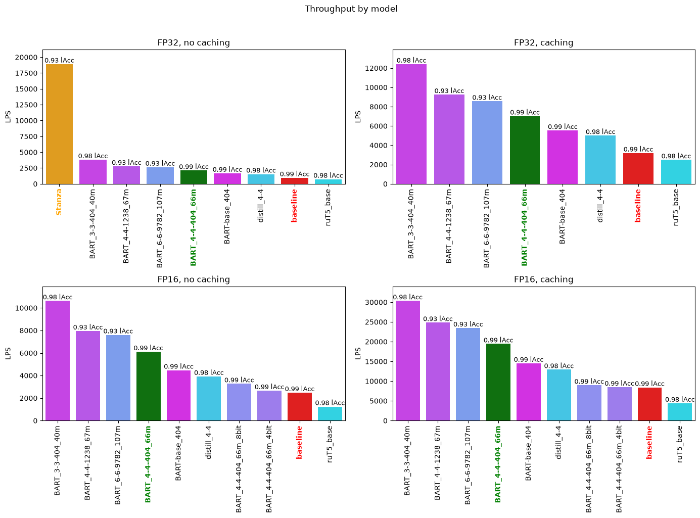

# Lemmatization-Benchmark-Harness

Обвязка для замеров качества/быстродействия генеративных моделей для задач лемматизации

Для перегенерации визуала:

```bash
uv run generate_visuals.py 
```

<!-- AUTO-GENERATED-BENCHMARKS:START -->

## Benchmark results

### Metrics

| Metric | Description |
| --- | --- |
| `LPS` | Amound of lemma predictions generated per second. |
| `lAcc` | Lemmatization Accuracy (Lyashevskaya et al., 2020), which is a standard accuracy metric, disregarding letter capitalization and е or ё choice in prediction and label. |
| `lAcc (norm)` | Lemmatization Accuracy calculated on lemmatized forms of both prediction and label. |
| `CER (total)` | Character Error Rate (MacKenzie & Soukoreff, 2002) calculated between alld predictions and their corresponding labels. |
| `CER (errors)` | Character Error Rate (MacKenzie & Soukoreff, 2002) calculated between wrong predictions and their corresponding labels. |

### Models

| Model | Parameters | Comment |
| --- | ---: | --- |
| `baseline` | 139,420,416 | RNC model (Afanasev et al., 2025) |
| `distill_4-4` | 92,330,752 | response-based distilled baseline |
| `ruT5_base` | 222,903,552 | This model exhibited comparable LPS while employing twice as much parameters because of the tokenizer |
| `BART_4-4-404_66m` | 66,628,608 | best performing BART model with 4 layers of encoder/decoder and an extended char-level BPE tokenizer |
| `BART_3-3-404` | 40,645,632 | BART model with 3 layers of encoder/decoder and an extended char-level BPE tokenizer |
| `BART_4-4-1238_67m` | 67,269,120 | BART model with 4 layers of encoder/decoder and a mowphologically-aware tokenizer (trained on corpus with unsplit affixes and splitted roots) |
| `BART_6-6-9782_107m` | 106,953,216 | BART model with 4 layers of encoder/decoder and a mowphologically-aware tokenizer |
| `BART-base_404` | 101,127,168 | BART-base model with an extended char-level BPE tokenizer |

| Tokenizer | Vocab size | Example input | Tokens | Example output |
| --- | ---: | --- | ---: | --- |
| BART-base BPE | 50,265 | `свежевскопанный` | 19 | `['<s>', 'Ñģ', 'в', 'е', 'Ð', '¶', 'е', 'в', 'Ñģ', 'к', 'оÐ', '¿', 'а', 'н', 'н', 'Ñĭ', 'Ð', '¹', '</s>']` |
| ruT5 BPE | 32,100 | `свежевскопанный` | 5 | `['▁свеже', 'в', 'скоп', 'анный', '</s>']` |
| Char-level tokenizer | 404 | `свежевскопанный` | 17 | `['[BOS]', 'с', 'в', 'е', 'ж', 'е', 'в', 'с', 'к', 'о', 'п', 'а', 'н', 'н', 'ы', 'й', '[EOS]']` |
| Morph-aware tokenizer | 9,782 | `свежевскопанный` | 10 | `['<s>', 'свеж', '##ев', '##ск', '##оп', '##ан', '##н', '##ы', '##й', '</s>']` |
| Morph-aware tokenizer with split roots | 1,238 | `свежевскопанный` | 14 | `['<s>', 'св', '##е', '##ж', '##е', '##в', '##ск', '##о', '##п', '##ан', '##н', '##ы', '##й', '</s>']` |
| Теоретический вариант на морфемах | — | `свежевскопанный` | 9 | `[<BOS>, 'свеж', 'е', 'вс', 'коп', 'а', 'нн', 'ый', <EOS>]` |
| Теоретический вариант на слогах | — | `свежевскопанный` | 7 | `[<BOS>, 'све', 'же', 'вско', 'па', 'нный', <EOS>]` |

### Throughput



### Quality

<h2> test

<h3>all</h3>
<table>
<thead>
<tr><th rowspan="2">model</th>
<th colspan="4">all</th>
<th colspan="4">1-100</th>
<th colspan="4">101-1000</th>
<th colspan="4">1001-10000</th>
<th colspan="4">10001-n</th>
<th colspan="4">punct</th>
</tr><tr>
<th>lAcc</th>
<th>lAcc_n</th>
<th>CER</th>
<th>CER_e</th>
<th>lAcc</th>
<th>lAcc_n</th>
<th>CER</th>
<th>CER_e</th>
<th>lAcc</th>
<th>lAcc_n</th>
<th>CER</th>
<th>CER_e</th>
<th>lAcc</th>
<th>lAcc_n</th>
<th>CER</th>
<th>CER_e</th>
<th>lAcc</th>
<th>lAcc_n</th>
<th>CER</th>
<th>CER_e</th>
<th>lAcc</th>
<th>lAcc_n</th>
<th>CER</th>
<th>CER_e</th>
</tr></thead><tbody>
<tr><td>baseline</td>
<td>0.991</td>
<td>0.992</td>
<td>0.004</td>
<td>0.409</td>
<td>0.999</td>
<td>0.999</td>
<td>0.001</td>
<td>0.590</td>
<td>0.995</td>
<td>0.995</td>
<td><strong>0.002</strong></td>
<td>0.308</td>
<td>0.986</td>
<td>0.988</td>
<td>0.003</td>
<td><strong>0.226</strong></td>
<td>0.952</td>
<td>0.957</td>
<td>0.023</td>
<td>0.476</td>
<td>1.000</td>
<td>1.000</td>
<td>0.001</td>
<td>1.429</td>
</tr>
<tr><td>BART_4-4-404_66m</td>
<td><strong>0.994</strong></td>
<td>0.995</td>
<td><strong>0.002</strong></td>
<td>0.308</td>
<td><strong>0.999</strong></td>
<td>0.999</td>
<td><strong>0.001</strong></td>
<td>0.548</td>
<td><strong>0.995</strong></td>
<td><strong>0.995</strong></td>
<td>0.002</td>
<td>0.402</td>
<td>0.994</td>
<td>0.996</td>
<td>0.002</td>
<td>0.315</td>
<td>0.970</td>
<td>0.976</td>
<td>0.007</td>
<td>0.248</td>
<td><strong>1.000</strong></td>
<td><strong>1.000</strong></td>
<td><strong>0.000</strong></td>
<td>0.700</td>
</tr>
<tr><td>distill_4-4</td>
<td>0.984</td>
<td>0.986</td>
<td>0.007</td>
<td>0.416</td>
<td>0.998</td>
<td>0.998</td>
<td>0.001</td>
<td>0.644</td>
<td>0.992</td>
<td>0.993</td>
<td>0.002</td>
<td><strong>0.294</strong></td>
<td>0.970</td>
<td>0.973</td>
<td>0.007</td>
<td>0.227</td>
<td>0.927</td>
<td>0.934</td>
<td>0.038</td>
<td>0.517</td>
<td>1.000</td>
<td>1.000</td>
<td>0.001</td>
<td>2.493</td>
</tr>
<tr><td>BART_4-4-1238_67m</td>
<td>0.935</td>
<td>0.936</td>
<td>0.043</td>
<td>0.658</td>
<td>0.997</td>
<td>0.997</td>
<td>0.003</td>
<td>0.951</td>
<td>0.956</td>
<td>0.956</td>
<td>0.026</td>
<td>0.592</td>
<td>0.952</td>
<td>0.953</td>
<td>0.032</td>
<td>0.653</td>
<td>0.862</td>
<td>0.868</td>
<td>0.094</td>
<td>0.684</td>
<td>0.856</td>
<td>0.856</td>
<td>0.094</td>
<td>0.653</td>
</tr>
<tr><td>BART_3-3-404_40m</td>
<td>0.982</td>
<td>0.985</td>
<td>0.005</td>
<td>0.276</td>
<td>0.998</td>
<td>0.998</td>
<td>0.001</td>
<td><strong>0.509</strong></td>
<td>0.989</td>
<td>0.990</td>
<td>0.004</td>
<td>0.353</td>
<td>0.965</td>
<td>0.969</td>
<td>0.008</td>
<td>0.243</td>
<td>0.922</td>
<td>0.938</td>
<td>0.020</td>
<td>0.260</td>
<td>0.999</td>
<td>0.999</td>
<td>0.000</td>
<td>0.840</td>
</tr>
<tr><td>ruT5_base</td>
<td>0.983</td>
<td>0.985</td>
<td>0.014</td>
<td>0.842</td>
<td>0.996</td>
<td>0.996</td>
<td>0.003</td>
<td>0.914</td>
<td>0.985</td>
<td>0.986</td>
<td>0.012</td>
<td>0.812</td>
<td>0.979</td>
<td>0.981</td>
<td>0.012</td>
<td>0.583</td>
<td>0.920</td>
<td>0.928</td>
<td>0.073</td>
<td>0.920</td>
<td>0.999</td>
<td>0.999</td>
<td>0.002</td>
<td>2.060</td>
</tr>
<tr><td>BART_6-6-9782_107m</td>
<td>0.933</td>
<td>0.934</td>
<td>0.044</td>
<td>0.662</td>
<td>0.996</td>
<td>0.996</td>
<td>0.004</td>
<td>1.034</td>
<td>0.957</td>
<td>0.957</td>
<td>0.028</td>
<td>0.648</td>
<td>0.947</td>
<td>0.949</td>
<td>0.035</td>
<td>0.659</td>
<td>0.851</td>
<td>0.857</td>
<td>0.099</td>
<td>0.662</td>
<td>0.856</td>
<td>0.856</td>
<td>0.094</td>
<td>0.653</td>
</tr>
<tr><td>Stanza</td>
<td>0.929</td>
<td>0.941</td>
<td>0.032</td>
<td>0.452</td>
<td>0.956</td>
<td>0.961</td>
<td>0.031</td>
<td>0.689</td>
<td>0.932</td>
<td>0.940</td>
<td>0.024</td>
<td>0.350</td>
<td>0.899</td>
<td>0.916</td>
<td>0.029</td>
<td>0.283</td>
<td>0.830</td>
<td>0.885</td>
<td>0.046</td>
<td>0.267</td>
<td>0.963</td>
<td>0.963</td>
<td>0.037</td>
<td>0.999</td>
</tr>
<tr><td>BART-base_404</td>
<td>0.989</td>
<td>0.990</td>
<td>0.003</td>
<td><strong>0.262</strong></td>
<td><strong>0.999</strong></td>
<td><strong>0.999</strong></td>
<td>0.001</td>
<td>0.572</td>
<td>0.993</td>
<td>0.994</td>
<td>0.003</td>
<td>0.377</td>
<td>0.982</td>
<td>0.985</td>
<td>0.004</td>
<td>0.230</td>
<td>0.943</td>
<td>0.952</td>
<td>0.013</td>
<td><strong>0.230</strong></td>
<td>0.999</td>
<td>0.999</td>
<td>0.000</td>
<td><strong>0.593</strong></td>
</tr>
<tr><td>BART_4-4-404_66m_8bit</td>
<td><strong>0.994</strong></td>
<td>0.995</td>
<td>0.002</td>
<td>0.307</td>
<td><strong>0.999</strong></td>
<td>0.999</td>
<td><strong>0.001</strong></td>
<td>0.548</td>
<td><strong>0.995</strong></td>
<td><strong>0.995</strong></td>
<td>0.002</td>
<td>0.402</td>
<td>0.994</td>
<td>0.996</td>
<td>0.002</td>
<td>0.315</td>
<td>0.970</td>
<td>0.976</td>
<td>0.007</td>
<td>0.248</td>
<td><strong>1.000</strong></td>
<td><strong>1.000</strong></td>
<td><strong>0.000</strong></td>
<td>0.700</td>
</tr>
<tr><td>BART_4-4-404_66m_4bit</td>
<td><strong>0.994</strong></td>
<td><strong>0.995</strong></td>
<td>0.002</td>
<td>0.308</td>
<td>0.999</td>
<td>0.999</td>
<td>0.001</td>
<td>0.527</td>
<td>0.995</td>
<td>0.995</td>
<td>0.002</td>
<td>0.409</td>
<td><strong>0.994</strong></td>
<td><strong>0.996</strong></td>
<td><strong>0.002</strong></td>
<td>0.313</td>
<td><strong>0.971</strong></td>
<td><strong>0.977</strong></td>
<td><strong>0.007</strong></td>
<td>0.247</td>
<td>1.000</td>
<td>1.000</td>
<td>0.000</td>
<td>0.667</td>
</tr>
</tbody></table>

<h3>holdout</h3>
<table>
<thead>
<tr><th rowspan="2">model</th>
<th colspan="4">all</th>
<th colspan="4">1-100</th>
<th colspan="4">101-1000</th>
<th colspan="4">1001-10000</th>
<th colspan="4">10001-n</th>
<th colspan="4">punct</th>
</tr><tr>
<th>lAcc</th>
<th>lAcc_n</th>
<th>CER</th>
<th>CER_e</th>
<th>lAcc</th>
<th>lAcc_n</th>
<th>CER</th>
<th>CER_e</th>
<th>lAcc</th>
<th>lAcc_n</th>
<th>CER</th>
<th>CER_e</th>
<th>lAcc</th>
<th>lAcc_n</th>
<th>CER</th>
<th>CER_e</th>
<th>lAcc</th>
<th>lAcc_n</th>
<th>CER</th>
<th>CER_e</th>
<th>lAcc</th>
<th>lAcc_n</th>
<th>CER</th>
<th>CER_e</th>
</tr></thead><tbody>
<tr><td>baseline</td>
<td>0.996</td>
<td>0.996</td>
<td>0.002</td>
<td>0.453</td>
<td>0.999</td>
<td>0.999</td>
<td>0.001</td>
<td>0.671</td>
<td>0.997</td>
<td>0.997</td>
<td><strong>0.001</strong></td>
<td>0.311</td>
<td>0.989</td>
<td>0.991</td>
<td>0.003</td>
<td>0.258</td>
<td>0.974</td>
<td>0.977</td>
<td>0.016</td>
<td>0.616</td>
<td>1.000</td>
<td>1.000</td>
<td>0.001</td>
<td>1.583</td>
</tr>
<tr><td>BART_4-4-404_66m</td>
<td>0.998</td>
<td><strong>0.998</strong></td>
<td>0.001</td>
<td>0.441</td>
<td>0.999</td>
<td>0.999</td>
<td><strong>0.001</strong></td>
<td>0.612</td>
<td><strong>0.997</strong></td>
<td><strong>0.997</strong></td>
<td>0.001</td>
<td>0.464</td>
<td>0.997</td>
<td>0.998</td>
<td>0.001</td>
<td>0.437</td>
<td>0.989</td>
<td>0.992</td>
<td>0.003</td>
<td>0.324</td>
<td><strong>1.000</strong></td>
<td><strong>1.000</strong></td>
<td><strong>0.000</strong></td>
<td>1.000</td>
</tr>
<tr><td>distill_4-4</td>
<td>0.993</td>
<td>0.993</td>
<td>0.003</td>
<td>0.450</td>
<td>0.999</td>
<td>0.999</td>
<td>0.001</td>
<td>0.702</td>
<td>0.995</td>
<td>0.996</td>
<td>0.001</td>
<td><strong>0.303</strong></td>
<td>0.980</td>
<td>0.982</td>
<td>0.005</td>
<td><strong>0.241</strong></td>
<td>0.957</td>
<td>0.961</td>
<td>0.028</td>
<td>0.642</td>
<td>1.000</td>
<td>1.000</td>
<td>0.001</td>
<td>2.917</td>
</tr>
<tr><td>BART_4-4-1238_67m</td>
<td>0.946</td>
<td>0.946</td>
<td>0.036</td>
<td>0.662</td>
<td>0.997</td>
<td>0.997</td>
<td>0.003</td>
<td>1.014</td>
<td>0.965</td>
<td>0.965</td>
<td>0.020</td>
<td>0.551</td>
<td>0.974</td>
<td>0.975</td>
<td>0.015</td>
<td>0.582</td>
<td>0.873</td>
<td>0.875</td>
<td>0.103</td>
<td>0.805</td>
<td>0.856</td>
<td>0.856</td>
<td>0.094</td>
<td>0.653</td>
</tr>
<tr><td>BART_3-3-404_40m</td>
<td>0.992</td>
<td>0.993</td>
<td>0.003</td>
<td><strong>0.330</strong></td>
<td>0.999</td>
<td>0.999</td>
<td>0.001</td>
<td><strong>0.570</strong></td>
<td>0.993</td>
<td>0.994</td>
<td>0.003</td>
<td>0.380</td>
<td>0.978</td>
<td>0.980</td>
<td>0.006</td>
<td>0.258</td>
<td>0.960</td>
<td>0.966</td>
<td>0.014</td>
<td>0.341</td>
<td>1.000</td>
<td>1.000</td>
<td>0.000</td>
<td>1.000</td>
</tr>
<tr><td>ruT5_base</td>
<td>0.993</td>
<td>0.993</td>
<td>0.006</td>
<td>0.801</td>
<td>0.996</td>
<td>0.996</td>
<td>0.003</td>
<td>0.874</td>
<td>0.989</td>
<td>0.990</td>
<td>0.009</td>
<td>0.860</td>
<td>0.991</td>
<td>0.992</td>
<td>0.005</td>
<td>0.566</td>
<td>0.960</td>
<td>0.963</td>
<td>0.030</td>
<td>0.743</td>
<td>0.999</td>
<td>0.999</td>
<td>0.002</td>
<td>2.060</td>
</tr>
<tr><td>BART_6-6-9782_107m</td>
<td>0.945</td>
<td>0.945</td>
<td>0.037</td>
<td>0.667</td>
<td>0.997</td>
<td>0.997</td>
<td>0.003</td>
<td>1.093</td>
<td>0.965</td>
<td>0.966</td>
<td>0.021</td>
<td>0.599</td>
<td>0.972</td>
<td>0.973</td>
<td>0.016</td>
<td>0.590</td>
<td>0.864</td>
<td>0.868</td>
<td>0.105</td>
<td>0.778</td>
<td>0.856</td>
<td>0.856</td>
<td>0.094</td>
<td>0.653</td>
</tr>
<tr><td>Stanza</td>
<td>0.949</td>
<td>0.955</td>
<td>0.029</td>
<td>0.555</td>
<td>0.957</td>
<td>0.962</td>
<td>0.030</td>
<td>0.692</td>
<td>0.942</td>
<td>0.949</td>
<td>0.021</td>
<td>0.359</td>
<td>0.934</td>
<td>0.946</td>
<td>0.019</td>
<td>0.295</td>
<td>0.901</td>
<td>0.929</td>
<td>0.034</td>
<td>0.342</td>
<td>0.963</td>
<td>0.963</td>
<td>0.037</td>
<td>1.000</td>
</tr>
<tr><td>BART-base_404</td>
<td>0.996</td>
<td>0.996</td>
<td>0.001</td>
<td>0.330</td>
<td><strong>0.999</strong></td>
<td><strong>0.999</strong></td>
<td>0.001</td>
<td>0.661</td>
<td>0.997</td>
<td>0.997</td>
<td>0.001</td>
<td>0.400</td>
<td>0.992</td>
<td>0.993</td>
<td>0.002</td>
<td>0.290</td>
<td>0.969</td>
<td>0.972</td>
<td>0.008</td>
<td><strong>0.263</strong></td>
<td>0.999</td>
<td>0.999</td>
<td>0.000</td>
<td><strong>0.642</strong></td>
</tr>
<tr><td>BART_4-4-404_66m_8bit</td>
<td><strong>0.998</strong></td>
<td><strong>0.998</strong></td>
<td>0.001</td>
<td>0.444</td>
<td>0.999</td>
<td>0.999</td>
<td><strong>0.001</strong></td>
<td>0.612</td>
<td><strong>0.997</strong></td>
<td><strong>0.997</strong></td>
<td>0.001</td>
<td>0.464</td>
<td>0.997</td>
<td>0.998</td>
<td>0.001</td>
<td>0.442</td>
<td><strong>0.989</strong></td>
<td>0.992</td>
<td><strong>0.003</strong></td>
<td>0.327</td>
<td><strong>1.000</strong></td>
<td><strong>1.000</strong></td>
<td><strong>0.000</strong></td>
<td>1.000</td>
</tr>
<tr><td>BART_4-4-404_66m_4bit</td>
<td>0.998</td>
<td>0.998</td>
<td><strong>0.001</strong></td>
<td>0.437</td>
<td>0.999</td>
<td>0.999</td>
<td>0.001</td>
<td>0.576</td>
<td><strong>0.997</strong></td>
<td><strong>0.997</strong></td>
<td>0.001</td>
<td>0.464</td>
<td><strong>0.997</strong></td>
<td><strong>0.998</strong></td>
<td><strong>0.001</strong></td>
<td>0.433</td>
<td>0.989</td>
<td><strong>0.992</strong></td>
<td>0.003</td>
<td>0.324</td>
<td><strong>1.000</strong></td>
<td><strong>1.000</strong></td>
<td><strong>0.000</strong></td>
<td>1.000</td>
</tr>
</tbody></table>

<h3>unknown</h3>
<table>
<thead>
<tr><th rowspan="2">model</th>
<th colspan="4">all</th>
<th colspan="4">1-100</th>
<th colspan="4">101-1000</th>
<th colspan="4">1001-10000</th>
<th colspan="4">10001-n</th>
<th colspan="4">punct</th>
</tr><tr>
<th>lAcc</th>
<th>lAcc_n</th>
<th>CER</th>
<th>CER_e</th>
<th>lAcc</th>
<th>lAcc_n</th>
<th>CER</th>
<th>CER_e</th>
<th>lAcc</th>
<th>lAcc_n</th>
<th>CER</th>
<th>CER_e</th>
<th>lAcc</th>
<th>lAcc_n</th>
<th>CER</th>
<th>CER_e</th>
<th>lAcc</th>
<th>lAcc_n</th>
<th>CER</th>
<th>CER_e</th>
<th>lAcc</th>
<th>lAcc_n</th>
<th>CER</th>
<th>CER_e</th>
</tr></thead><tbody>
<tr><td>baseline</td>
<td>0.943</td>
<td>0.949</td>
<td>0.021</td>
<td>0.377</td>
<td>0.877</td>
<td>0.884</td>
<td><strong>0.043</strong></td>
<td><strong>0.351</strong></td>
<td><strong>0.944</strong></td>
<td><strong>0.951</strong></td>
<td><strong>0.017</strong></td>
<td>0.303</td>
<td>0.968</td>
<td>0.972</td>
<td>0.006</td>
<td><strong>0.172</strong></td>
<td>0.933</td>
<td>0.940</td>
<td>0.029</td>
<td>0.428</td>
<td>0.500</td>
<td>0.500</td>
<td>0.405</td>
<td>0.810</td>
</tr>
<tr><td>BART_4-4-404_66m</td>
<td>0.959</td>
<td>0.966</td>
<td><strong>0.010</strong></td>
<td>0.249</td>
<td>0.856</td>
<td>0.870</td>
<td>0.060</td>
<td>0.420</td>
<td>0.937</td>
<td>0.944</td>
<td>0.021</td>
<td>0.329</td>
<td>0.979</td>
<td>0.983</td>
<td>0.005</td>
<td>0.231</td>
<td>0.954</td>
<td>0.962</td>
<td>0.011</td>
<td>0.233</td>
<td>0.667</td>
<td>0.667</td>
<td>0.083</td>
<td>0.250</td>
</tr>
<tr><td>distill_4-4</td>
<td>0.905</td>
<td>0.914</td>
<td>0.037</td>
<td>0.392</td>
<td>0.829</td>
<td>0.856</td>
<td>0.085</td>
<td>0.495</td>
<td>0.903</td>
<td>0.914</td>
<td>0.027</td>
<td><strong>0.282</strong></td>
<td>0.918</td>
<td>0.925</td>
<td>0.017</td>
<td>0.210</td>
<td>0.901</td>
<td>0.911</td>
<td>0.046</td>
<td>0.470</td>
<td>0.500</td>
<td>0.500</td>
<td>0.399</td>
<td>0.797</td>
</tr>
<tr><td>BART_4-4-1238_67m</td>
<td>0.838</td>
<td>0.844</td>
<td>0.104</td>
<td>0.645</td>
<td>0.733</td>
<td>0.740</td>
<td>0.201</td>
<td>0.753</td>
<td>0.730</td>
<td>0.734</td>
<td>0.198</td>
<td>0.733</td>
<td>0.834</td>
<td>0.836</td>
<td>0.118</td>
<td>0.709</td>
<td>0.854</td>
<td>0.862</td>
<td>0.087</td>
<td>0.592</td>
<td>0.167</td>
<td>0.167</td>
<td>0.297</td>
<td>0.356</td>
</tr>
<tr><td>BART_3-3-404_40m</td>
<td>0.890</td>
<td>0.910</td>
<td>0.027</td>
<td>0.241</td>
<td>0.774</td>
<td>0.788</td>
<td>0.091</td>
<td>0.404</td>
<td>0.877</td>
<td>0.887</td>
<td>0.038</td>
<td>0.311</td>
<td>0.900</td>
<td>0.912</td>
<td>0.023</td>
<td>0.225</td>
<td>0.889</td>
<td>0.914</td>
<td>0.026</td>
<td>0.235</td>
<td>0.333</td>
<td>0.333</td>
<td>0.186</td>
<td>0.279</td>
</tr>
<tr><td>ruT5_base</td>
<td>0.894</td>
<td>0.904</td>
<td>0.092</td>
<td>0.868</td>
<td><strong>0.904</strong></td>
<td><strong>0.911</strong></td>
<td>0.135</td>
<td>1.410</td>
<td>0.872</td>
<td>0.880</td>
<td>0.091</td>
<td>0.708</td>
<td>0.917</td>
<td>0.923</td>
<td>0.049</td>
<td>0.593</td>
<td>0.886</td>
<td>0.898</td>
<td>0.111</td>
<td>0.974</td>
<td><strong>1.000</strong></td>
<td><strong>1.000</strong></td>
<td><strong>0.000</strong></td>
<td><strong>0.000</strong></td>
</tr>
<tr><td>BART_6-6-9782_107m</td>
<td>0.825</td>
<td>0.831</td>
<td>0.113</td>
<td>0.647</td>
<td>0.726</td>
<td>0.747</td>
<td>0.230</td>
<td>0.838</td>
<td>0.728</td>
<td>0.733</td>
<td>0.222</td>
<td>0.815</td>
<td>0.820</td>
<td>0.822</td>
<td>0.129</td>
<td>0.715</td>
<td>0.839</td>
<td>0.847</td>
<td>0.093</td>
<td>0.578</td>
<td>0.167</td>
<td>0.167</td>
<td>0.297</td>
<td>0.356</td>
</tr>
<tr><td>Stanza</td>
<td>0.745</td>
<td>0.809</td>
<td>0.066</td>
<td>0.259</td>
<td>0.644</td>
<td>0.671</td>
<td>0.206</td>
<td>0.578</td>
<td>0.671</td>
<td>0.693</td>
<td>0.100</td>
<td>0.305</td>
<td>0.717</td>
<td>0.760</td>
<td>0.076</td>
<td>0.269</td>
<td>0.768</td>
<td>0.846</td>
<td>0.056</td>
<td>0.239</td>
<td>0.667</td>
<td>0.667</td>
<td>0.125</td>
<td>0.375</td>
</tr>
<tr><td>BART-base_404</td>
<td>0.921</td>
<td>0.934</td>
<td>0.018</td>
<td><strong>0.229</strong></td>
<td>0.836</td>
<td>0.856</td>
<td>0.070</td>
<td>0.428</td>
<td>0.893</td>
<td>0.907</td>
<td>0.038</td>
<td>0.360</td>
<td>0.932</td>
<td>0.940</td>
<td>0.013</td>
<td>0.193</td>
<td>0.920</td>
<td>0.935</td>
<td>0.017</td>
<td><strong>0.219</strong></td>
<td>0.500</td>
<td>0.500</td>
<td>0.141</td>
<td>0.282</td>
</tr>
<tr><td>BART_4-4-404_66m_8bit</td>
<td>0.959</td>
<td>0.966</td>
<td>0.010</td>
<td>0.248</td>
<td>0.856</td>
<td>0.870</td>
<td>0.060</td>
<td>0.420</td>
<td>0.937</td>
<td>0.944</td>
<td>0.021</td>
<td>0.329</td>
<td>0.979</td>
<td>0.983</td>
<td><strong>0.005</strong></td>
<td>0.229</td>
<td>0.954</td>
<td>0.962</td>
<td>0.011</td>
<td>0.232</td>
<td>0.667</td>
<td>0.667</td>
<td>0.083</td>
<td>0.250</td>
</tr>
<tr><td>BART_4-4-404_66m_4bit</td>
<td><strong>0.959</strong></td>
<td><strong>0.967</strong></td>
<td>0.010</td>
<td>0.250</td>
<td>0.856</td>
<td>0.870</td>
<td>0.060</td>
<td>0.420</td>
<td>0.936</td>
<td>0.943</td>
<td>0.022</td>
<td>0.345</td>
<td><strong>0.979</strong></td>
<td><strong>0.984</strong></td>
<td>0.005</td>
<td>0.232</td>
<td><strong>0.954</strong></td>
<td><strong>0.963</strong></td>
<td><strong>0.011</strong></td>
<td>0.232</td>
<td>0.500</td>
<td>0.500</td>
<td>0.167</td>
<td>0.333</td>
</tr>
</tbody></table> </h2>
<h2> school

<h3>all</h3>
<table>
<thead>
<tr><th rowspan="2">model</th>
<th colspan="4">all</th>
<th colspan="4">1-100</th>
<th colspan="4">101-1000</th>
<th colspan="4">1001-10000</th>
<th colspan="4">10001-n</th>
<th colspan="4">punct</th>
</tr><tr>
<th>lAcc</th>
<th>lAcc_n</th>
<th>CER</th>
<th>CER_e</th>
<th>lAcc</th>
<th>lAcc_n</th>
<th>CER</th>
<th>CER_e</th>
<th>lAcc</th>
<th>lAcc_n</th>
<th>CER</th>
<th>CER_e</th>
<th>lAcc</th>
<th>lAcc_n</th>
<th>CER</th>
<th>CER_e</th>
<th>lAcc</th>
<th>lAcc_n</th>
<th>CER</th>
<th>CER_e</th>
<th>lAcc</th>
<th>lAcc_n</th>
<th>CER</th>
<th>CER_e</th>
</tr></thead><tbody>
<tr><td>baseline</td>
<td>0.989</td>
<td>0.991</td>
<td>0.004</td>
<td><strong>0.377</strong></td>
<td>0.998</td>
<td>0.998</td>
<td>0.001</td>
<td>0.584</td>
<td>0.988</td>
<td>0.989</td>
<td>0.003</td>
<td><strong>0.260</strong></td>
<td>0.986</td>
<td>0.989</td>
<td>0.003</td>
<td><strong>0.215</strong></td>
<td>0.956</td>
<td>0.963</td>
<td>0.021</td>
<td>0.478</td>
<td>1.000</td>
<td>1.000</td>
<td>0.000</td>
<td>1.187</td>
</tr>
<tr><td>BART_4-4-404_66m</td>
<td>0.994</td>
<td>0.995</td>
<td>0.003</td>
<td>0.409</td>
<td>0.999</td>
<td>0.999</td>
<td>0.001</td>
<td>0.998</td>
<td>0.995</td>
<td>0.995</td>
<td>0.002</td>
<td>0.354</td>
<td>0.996</td>
<td>0.997</td>
<td>0.002</td>
<td>0.409</td>
<td><strong>0.964</strong></td>
<td>0.972</td>
<td>0.014</td>
<td>0.373</td>
<td><strong>1.000</strong></td>
<td><strong>1.000</strong></td>
<td><strong>0.000</strong></td>
<td>1.000</td>
</tr>
<tr><td>distill_4-4</td>
<td>0.987</td>
<td>0.989</td>
<td>0.006</td>
<td>0.422</td>
<td>0.999</td>
<td>0.999</td>
<td><strong>0.001</strong></td>
<td>0.732</td>
<td>0.993</td>
<td>0.993</td>
<td>0.002</td>
<td>0.297</td>
<td>0.977</td>
<td>0.980</td>
<td>0.005</td>
<td>0.217</td>
<td>0.940</td>
<td>0.952</td>
<td>0.030</td>
<td>0.506</td>
<td>0.999</td>
<td>0.999</td>
<td>0.002</td>
<td>2.907</td>
</tr>
<tr><td>BART_4-4-1238_67m</td>
<td>0.933</td>
<td>0.935</td>
<td>0.047</td>
<td>0.702</td>
<td>0.999</td>
<td>0.999</td>
<td>0.002</td>
<td>1.581</td>
<td>0.987</td>
<td>0.987</td>
<td>0.005</td>
<td>0.344</td>
<td>0.989</td>
<td>0.990</td>
<td>0.004</td>
<td>0.346</td>
<td>0.906</td>
<td>0.916</td>
<td>0.057</td>
<td>0.608</td>
<td>0.775</td>
<td>0.775</td>
<td>0.169</td>
<td>0.749</td>
</tr>
<tr><td>BART_3-3-404_40m</td>
<td>0.983</td>
<td>0.986</td>
<td>0.011</td>
<td>0.626</td>
<td>0.992</td>
<td>0.992</td>
<td>0.023</td>
<td>2.825</td>
<td>0.993</td>
<td>0.993</td>
<td>0.003</td>
<td>0.398</td>
<td>0.975</td>
<td>0.978</td>
<td>0.006</td>
<td>0.241</td>
<td>0.932</td>
<td>0.945</td>
<td>0.019</td>
<td>0.282</td>
<td>1.000</td>
<td>1.000</td>
<td>0.000</td>
<td>0.987</td>
</tr>
<tr><td>ruT5_base</td>
<td>0.992</td>
<td>0.993</td>
<td>0.007</td>
<td>0.831</td>
<td><strong>0.999</strong></td>
<td><strong>0.999</strong></td>
<td>0.001</td>
<td>0.929</td>
<td><strong>0.997</strong></td>
<td><strong>0.997</strong></td>
<td><strong>0.002</strong></td>
<td>0.514</td>
<td>0.995</td>
<td>0.996</td>
<td>0.002</td>
<td>0.489</td>
<td>0.960</td>
<td>0.970</td>
<td>0.016</td>
<td>0.402</td>
<td>0.994</td>
<td>0.994</td>
<td>0.016</td>
<td>2.781</td>
</tr>
<tr><td>BART_6-6-9782_107m</td>
<td>0.931</td>
<td>0.932</td>
<td>0.051</td>
<td>0.734</td>
<td>0.998</td>
<td>0.998</td>
<td>0.011</td>
<td>4.998</td>
<td>0.986</td>
<td>0.987</td>
<td>0.006</td>
<td>0.469</td>
<td>0.986</td>
<td>0.987</td>
<td>0.006</td>
<td>0.433</td>
<td>0.898</td>
<td>0.906</td>
<td>0.059</td>
<td>0.575</td>
<td>0.775</td>
<td>0.775</td>
<td>0.169</td>
<td>0.749</td>
</tr>
<tr><td>Stanza</td>
<td>0.944</td>
<td>0.957</td>
<td>0.033</td>
<td>0.601</td>
<td>0.990</td>
<td>0.998</td>
<td>0.005</td>
<td><strong>0.500</strong></td>
<td>0.971</td>
<td>0.976</td>
<td>0.010</td>
<td>0.336</td>
<td>0.952</td>
<td>0.964</td>
<td>0.014</td>
<td>0.290</td>
<td>0.880</td>
<td>0.941</td>
<td>0.030</td>
<td><strong>0.254</strong></td>
<td>0.893</td>
<td>0.893</td>
<td>0.107</td>
<td>1.000</td>
</tr>
<tr><td>BART-base_404</td>
<td>0.987</td>
<td>0.989</td>
<td>0.014</td>
<td>1.069</td>
<td>0.991</td>
<td>0.991</td>
<td>0.038</td>
<td>4.328</td>
<td>0.993</td>
<td>0.993</td>
<td>0.005</td>
<td>0.679</td>
<td>0.986</td>
<td>0.989</td>
<td>0.003</td>
<td>0.236</td>
<td>0.943</td>
<td>0.953</td>
<td>0.017</td>
<td>0.292</td>
<td>1.000</td>
<td>1.000</td>
<td>0.000</td>
<td><strong>0.638</strong></td>
</tr>
<tr><td>BART_4-4-404_66m_8bit</td>
<td>0.994</td>
<td>0.995</td>
<td>0.003</td>
<td>0.409</td>
<td>0.999</td>
<td>0.999</td>
<td>0.001</td>
<td>1.004</td>
<td>0.995</td>
<td>0.995</td>
<td>0.002</td>
<td>0.354</td>
<td>0.996</td>
<td>0.997</td>
<td>0.002</td>
<td>0.409</td>
<td><strong>0.964</strong></td>
<td>0.972</td>
<td>0.014</td>
<td>0.373</td>
<td><strong>1.000</strong></td>
<td><strong>1.000</strong></td>
<td><strong>0.000</strong></td>
<td>1.000</td>
</tr>
<tr><td>BART_4-4-404_66m_4bit</td>
<td><strong>0.994</strong></td>
<td><strong>0.995</strong></td>
<td><strong>0.003</strong></td>
<td>0.407</td>
<td>0.999</td>
<td><strong>0.999</strong></td>
<td>0.001</td>
<td>0.991</td>
<td>0.995</td>
<td>0.995</td>
<td>0.002</td>
<td>0.361</td>
<td><strong>0.996</strong></td>
<td><strong>0.997</strong></td>
<td><strong>0.001</strong></td>
<td>0.410</td>
<td><strong>0.964</strong></td>
<td><strong>0.972</strong></td>
<td><strong>0.014</strong></td>
<td>0.372</td>
<td><strong>1.000</strong></td>
<td><strong>1.000</strong></td>
<td><strong>0.000</strong></td>
<td>1.000</td>
</tr>
</tbody></table>

<h3>holdout</h3>
<table>
<thead>
<tr><th rowspan="2">model</th>
<th colspan="4">all</th>
<th colspan="4">1-100</th>
<th colspan="4">101-1000</th>
<th colspan="4">1001-10000</th>
<th colspan="4">10001-n</th>
<th colspan="4">punct</th>
</tr><tr>
<th>lAcc</th>
<th>lAcc_n</th>
<th>CER</th>
<th>CER_e</th>
<th>lAcc</th>
<th>lAcc_n</th>
<th>CER</th>
<th>CER_e</th>
<th>lAcc</th>
<th>lAcc_n</th>
<th>CER</th>
<th>CER_e</th>
<th>lAcc</th>
<th>lAcc_n</th>
<th>CER</th>
<th>CER_e</th>
<th>lAcc</th>
<th>lAcc_n</th>
<th>CER</th>
<th>CER_e</th>
<th>lAcc</th>
<th>lAcc_n</th>
<th>CER</th>
<th>CER_e</th>
</tr></thead><tbody>
<tr><td>baseline</td>
<td>0.990</td>
<td>0.992</td>
<td>0.003</td>
<td><strong>0.269</strong></td>
<td><strong>0.999</strong></td>
<td><strong>0.999</strong></td>
<td>0.001</td>
<td>0.549</td>
<td>0.990</td>
<td>0.991</td>
<td>0.002</td>
<td><strong>0.254</strong></td>
<td>0.986</td>
<td>0.990</td>
<td>0.003</td>
<td><strong>0.210</strong></td>
<td>0.976</td>
<td>0.982</td>
<td>0.009</td>
<td>0.361</td>
<td><strong>0.000</strong></td>
<td><strong>0.000</strong></td>
<td><strong>0.000</strong></td>
<td><strong>0.000</strong></td>
</tr>
<tr><td>BART_4-4-404_66m</td>
<td>0.994</td>
<td>0.995</td>
<td>0.003</td>
<td>0.418</td>
<td>0.999</td>
<td>0.999</td>
<td>0.001</td>
<td>0.606</td>
<td>0.995</td>
<td>0.995</td>
<td>0.002</td>
<td>0.344</td>
<td>0.998</td>
<td>0.998</td>
<td>0.001</td>
<td>0.476</td>
<td>0.963</td>
<td>0.969</td>
<td>0.016</td>
<td>0.420</td>
<td><strong>0.000</strong></td>
<td><strong>0.000</strong></td>
<td><strong>0.000</strong></td>
<td><strong>0.000</strong></td>
</tr>
<tr><td>distill_4-4</td>
<td>0.988</td>
<td>0.989</td>
<td>0.004</td>
<td>0.300</td>
<td>0.999</td>
<td>0.999</td>
<td>0.001</td>
<td>0.633</td>
<td>0.993</td>
<td>0.993</td>
<td>0.002</td>
<td>0.285</td>
<td>0.980</td>
<td>0.983</td>
<td>0.004</td>
<td>0.216</td>
<td>0.965</td>
<td>0.974</td>
<td>0.015</td>
<td>0.429</td>
<td><strong>0.000</strong></td>
<td><strong>0.000</strong></td>
<td><strong>0.000</strong></td>
<td><strong>0.000</strong></td>
</tr>
<tr><td>BART_4-4-1238_67m</td>
<td>0.983</td>
<td>0.984</td>
<td>0.010</td>
<td>0.596</td>
<td>0.999</td>
<td>0.999</td>
<td>0.001</td>
<td>0.553</td>
<td>0.988</td>
<td>0.988</td>
<td>0.004</td>
<td>0.310</td>
<td>0.992</td>
<td>0.993</td>
<td>0.002</td>
<td>0.316</td>
<td>0.893</td>
<td>0.899</td>
<td>0.082</td>
<td>0.766</td>
<td><strong>0.000</strong></td>
<td><strong>0.000</strong></td>
<td><strong>0.000</strong></td>
<td><strong>0.000</strong></td>
</tr>
<tr><td>BART_3-3-404_40m</td>
<td>0.986</td>
<td>0.988</td>
<td>0.004</td>
<td>0.318</td>
<td>0.998</td>
<td>0.998</td>
<td>0.001</td>
<td>0.580</td>
<td>0.994</td>
<td>0.995</td>
<td>0.003</td>
<td>0.413</td>
<td>0.981</td>
<td>0.984</td>
<td>0.005</td>
<td>0.242</td>
<td>0.941</td>
<td>0.951</td>
<td>0.020</td>
<td>0.346</td>
<td><strong>0.000</strong></td>
<td><strong>0.000</strong></td>
<td><strong>0.000</strong></td>
<td><strong>0.000</strong></td>
</tr>
<tr><td>ruT5_base</td>
<td><strong>0.997</strong></td>
<td><strong>0.998</strong></td>
<td><strong>0.001</strong></td>
<td>0.405</td>
<td>0.999</td>
<td>0.999</td>
<td>0.001</td>
<td>0.597</td>
<td><strong>0.997</strong></td>
<td>0.997</td>
<td>0.001</td>
<td>0.497</td>
<td>0.997</td>
<td>0.998</td>
<td>0.001</td>
<td>0.477</td>
<td><strong>0.988</strong></td>
<td><strong>0.995</strong></td>
<td><strong>0.003</strong></td>
<td><strong>0.225</strong></td>
<td><strong>0.000</strong></td>
<td><strong>0.000</strong></td>
<td><strong>0.000</strong></td>
<td><strong>0.000</strong></td>
</tr>
<tr><td>BART_6-6-9782_107m</td>
<td>0.982</td>
<td>0.983</td>
<td>0.010</td>
<td>0.579</td>
<td>0.999</td>
<td>0.999</td>
<td><strong>0.001</strong></td>
<td>0.502</td>
<td>0.988</td>
<td>0.988</td>
<td>0.004</td>
<td>0.314</td>
<td>0.990</td>
<td>0.992</td>
<td>0.003</td>
<td>0.324</td>
<td>0.889</td>
<td>0.896</td>
<td>0.083</td>
<td>0.748</td>
<td><strong>0.000</strong></td>
<td><strong>0.000</strong></td>
<td><strong>0.000</strong></td>
<td><strong>0.000</strong></td>
</tr>
<tr><td>Stanza</td>
<td>0.972</td>
<td>0.978</td>
<td>0.008</td>
<td>0.298</td>
<td>0.996</td>
<td>0.996</td>
<td>0.002</td>
<td><strong>0.496</strong></td>
<td>0.975</td>
<td>0.976</td>
<td>0.007</td>
<td>0.294</td>
<td>0.962</td>
<td>0.970</td>
<td>0.011</td>
<td>0.292</td>
<td>0.929</td>
<td>0.964</td>
<td>0.020</td>
<td>0.282</td>
<td><strong>0.000</strong></td>
<td><strong>0.000</strong></td>
<td><strong>0.000</strong></td>
<td><strong>0.000</strong></td>
</tr>
<tr><td>BART-base_404</td>
<td>0.991</td>
<td>0.992</td>
<td>0.003</td>
<td>0.325</td>
<td>0.999</td>
<td>0.999</td>
<td>0.001</td>
<td>0.622</td>
<td>0.997</td>
<td><strong>0.998</strong></td>
<td><strong>0.001</strong></td>
<td>0.410</td>
<td>0.989</td>
<td>0.992</td>
<td>0.002</td>
<td>0.226</td>
<td>0.951</td>
<td>0.958</td>
<td>0.017</td>
<td>0.357</td>
<td><strong>0.000</strong></td>
<td><strong>0.000</strong></td>
<td><strong>0.000</strong></td>
<td><strong>0.000</strong></td>
</tr>
<tr><td>BART_4-4-404_66m_8bit</td>
<td>0.994</td>
<td>0.995</td>
<td>0.003</td>
<td>0.418</td>
<td>0.999</td>
<td>0.999</td>
<td>0.001</td>
<td>0.606</td>
<td>0.995</td>
<td>0.995</td>
<td>0.002</td>
<td>0.344</td>
<td>0.997</td>
<td>0.998</td>
<td>0.001</td>
<td>0.476</td>
<td>0.963</td>
<td>0.969</td>
<td>0.016</td>
<td>0.421</td>
<td><strong>0.000</strong></td>
<td><strong>0.000</strong></td>
<td><strong>0.000</strong></td>
<td><strong>0.000</strong></td>
</tr>
<tr><td>BART_4-4-404_66m_4bit</td>
<td>0.994</td>
<td>0.995</td>
<td>0.003</td>
<td>0.415</td>
<td><strong>0.999</strong></td>
<td><strong>0.999</strong></td>
<td>0.001</td>
<td>0.542</td>
<td>0.995</td>
<td>0.995</td>
<td>0.002</td>
<td>0.352</td>
<td><strong>0.998</strong></td>
<td><strong>0.998</strong></td>
<td><strong>0.001</strong></td>
<td>0.475</td>
<td>0.963</td>
<td>0.969</td>
<td>0.016</td>
<td>0.420</td>
<td><strong>0.000</strong></td>
<td><strong>0.000</strong></td>
<td><strong>0.000</strong></td>
<td><strong>0.000</strong></td>
</tr>
</tbody></table>

<h3>unknown</h3>
<table>
<thead>
<tr><th rowspan="2">model</th>
<th colspan="4">all</th>
<th colspan="4">1-100</th>
<th colspan="4">101-1000</th>
<th colspan="4">1001-10000</th>
<th colspan="4">10001-n</th>
<th colspan="4">punct</th>
</tr><tr>
<th>lAcc</th>
<th>lAcc_n</th>
<th>CER</th>
<th>CER_e</th>
<th>lAcc</th>
<th>lAcc_n</th>
<th>CER</th>
<th>CER_e</th>
<th>lAcc</th>
<th>lAcc_n</th>
<th>CER</th>
<th>CER_e</th>
<th>lAcc</th>
<th>lAcc_n</th>
<th>CER</th>
<th>CER_e</th>
<th>lAcc</th>
<th>lAcc_n</th>
<th>CER</th>
<th>CER_e</th>
<th>lAcc</th>
<th>lAcc_n</th>
<th>CER</th>
<th>CER_e</th>
</tr></thead><tbody>
<tr><td>baseline</td>
<td>0.989</td>
<td>0.990</td>
<td>0.005</td>
<td>0.480</td>
<td>0.998</td>
<td>0.998</td>
<td>0.001</td>
<td>0.605</td>
<td>0.967</td>
<td>0.967</td>
<td>0.009</td>
<td><strong>0.277</strong></td>
<td>0.987</td>
<td>0.987</td>
<td>0.003</td>
<td>0.245</td>
<td>0.942</td>
<td>0.950</td>
<td>0.030</td>
<td>0.512</td>
<td>1.000</td>
<td>1.000</td>
<td>0.000</td>
<td>1.187</td>
</tr>
<tr><td>BART_4-4-404_66m</td>
<td>0.994</td>
<td>0.995</td>
<td>0.003</td>
<td>0.400</td>
<td>0.999</td>
<td>0.999</td>
<td>0.002</td>
<td>1.410</td>
<td><strong>0.997</strong></td>
<td><strong>0.997</strong></td>
<td><strong>0.002</strong></td>
<td>0.502</td>
<td>0.989</td>
<td>0.991</td>
<td>0.003</td>
<td>0.319</td>
<td>0.964</td>
<td>0.973</td>
<td>0.012</td>
<td>0.339</td>
<td><strong>1.000</strong></td>
<td><strong>1.000</strong></td>
<td><strong>0.000</strong></td>
<td>1.000</td>
</tr>
<tr><td>distill_4-4</td>
<td>0.985</td>
<td>0.988</td>
<td>0.008</td>
<td>0.534</td>
<td><strong>0.999</strong></td>
<td>0.999</td>
<td><strong>0.001</strong></td>
<td>0.914</td>
<td>0.994</td>
<td>0.994</td>
<td>0.003</td>
<td>0.436</td>
<td>0.958</td>
<td>0.963</td>
<td>0.009</td>
<td><strong>0.222</strong></td>
<td>0.923</td>
<td>0.937</td>
<td>0.041</td>
<td>0.531</td>
<td>0.999</td>
<td>0.999</td>
<td>0.002</td>
<td>2.907</td>
</tr>
<tr><td>BART_4-4-1238_67m</td>
<td>0.880</td>
<td>0.882</td>
<td>0.086</td>
<td>0.718</td>
<td>0.999</td>
<td>0.999</td>
<td>0.003</td>
<td>2.559</td>
<td>0.972</td>
<td>0.972</td>
<td>0.014</td>
<td>0.485</td>
<td>0.972</td>
<td>0.974</td>
<td>0.011</td>
<td>0.393</td>
<td>0.916</td>
<td>0.927</td>
<td>0.039</td>
<td>0.466</td>
<td>0.775</td>
<td>0.775</td>
<td>0.169</td>
<td>0.749</td>
</tr>
<tr><td>BART_3-3-404_40m</td>
<td>0.980</td>
<td>0.983</td>
<td>0.017</td>
<td>0.860</td>
<td>0.986</td>
<td>0.986</td>
<td>0.044</td>
<td>3.066</td>
<td>0.981</td>
<td>0.983</td>
<td>0.006</td>
<td>0.349</td>
<td>0.939</td>
<td>0.947</td>
<td>0.015</td>
<td>0.239</td>
<td>0.925</td>
<td>0.940</td>
<td>0.019</td>
<td>0.247</td>
<td>1.000</td>
<td>1.000</td>
<td>0.000</td>
<td>0.987</td>
</tr>
<tr><td>ruT5_base</td>
<td>0.987</td>
<td>0.989</td>
<td>0.012</td>
<td>0.949</td>
<td>0.999</td>
<td>0.999</td>
<td>0.001</td>
<td>1.414</td>
<td>0.994</td>
<td>0.994</td>
<td>0.003</td>
<td>0.590</td>
<td>0.984</td>
<td>0.986</td>
<td>0.008</td>
<td>0.502</td>
<td>0.941</td>
<td>0.953</td>
<td>0.025</td>
<td>0.427</td>
<td>0.994</td>
<td>0.994</td>
<td>0.016</td>
<td>2.781</td>
</tr>
<tr><td>BART_6-6-9782_107m</td>
<td>0.877</td>
<td>0.879</td>
<td>0.093</td>
<td>0.759</td>
<td>0.997</td>
<td>0.997</td>
<td>0.021</td>
<td>6.637</td>
<td>0.968</td>
<td>0.969</td>
<td>0.032</td>
<td>1.024</td>
<td>0.962</td>
<td>0.963</td>
<td>0.023</td>
<td>0.599</td>
<td>0.904</td>
<td>0.913</td>
<td>0.042</td>
<td>0.435</td>
<td>0.775</td>
<td>0.775</td>
<td>0.169</td>
<td>0.749</td>
</tr>
<tr><td>Stanza</td>
<td>0.915</td>
<td>0.934</td>
<td>0.060</td>
<td>0.706</td>
<td>0.985</td>
<td><strong>0.999</strong></td>
<td>0.007</td>
<td><strong>0.501</strong></td>
<td>0.934</td>
<td>0.974</td>
<td>0.032</td>
<td>0.488</td>
<td>0.893</td>
<td>0.925</td>
<td>0.031</td>
<td>0.287</td>
<td>0.846</td>
<td>0.925</td>
<td>0.038</td>
<td><strong>0.244</strong></td>
<td>0.893</td>
<td>0.893</td>
<td>0.107</td>
<td>1.000</td>
</tr>
<tr><td>BART-base_404</td>
<td>0.982</td>
<td>0.984</td>
<td>0.026</td>
<td>1.490</td>
<td>0.984</td>
<td>0.984</td>
<td>0.074</td>
<td>4.640</td>
<td>0.948</td>
<td>0.949</td>
<td>0.043</td>
<td>0.817</td>
<td>0.968</td>
<td>0.971</td>
<td>0.008</td>
<td>0.256</td>
<td>0.938</td>
<td>0.950</td>
<td>0.016</td>
<td>0.257</td>
<td>1.000</td>
<td>1.000</td>
<td>0.000</td>
<td><strong>0.638</strong></td>
</tr>
<tr><td>BART_4-4-404_66m_8bit</td>
<td>0.994</td>
<td>0.995</td>
<td>0.003</td>
<td><strong>0.399</strong></td>
<td>0.999</td>
<td>0.999</td>
<td>0.002</td>
<td>1.438</td>
<td><strong>0.997</strong></td>
<td><strong>0.997</strong></td>
<td><strong>0.002</strong></td>
<td>0.502</td>
<td>0.989</td>
<td>0.991</td>
<td>0.003</td>
<td>0.319</td>
<td>0.964</td>
<td>0.973</td>
<td>0.012</td>
<td>0.339</td>
<td><strong>1.000</strong></td>
<td><strong>1.000</strong></td>
<td><strong>0.000</strong></td>
<td>1.000</td>
</tr>
<tr><td>BART_4-4-404_66m_4bit</td>
<td><strong>0.994</strong></td>
<td><strong>0.995</strong></td>
<td><strong>0.003</strong></td>
<td>0.399</td>
<td>0.999</td>
<td>0.999</td>
<td>0.002</td>
<td>1.420</td>
<td>0.996</td>
<td>0.997</td>
<td>0.002</td>
<td>0.498</td>
<td><strong>0.990</strong></td>
<td><strong>0.991</strong></td>
<td><strong>0.003</strong></td>
<td>0.321</td>
<td><strong>0.964</strong></td>
<td><strong>0.973</strong></td>
<td><strong>0.012</strong></td>
<td>0.337</td>
<td><strong>1.000</strong></td>
<td><strong>1.000</strong></td>
<td><strong>0.000</strong></td>
<td>1.000</td>
</tr>
</tbody></table> </h2>
<h2> poetic_18

<h3>all</h3>
<table>
<thead>
<tr><th rowspan="2">model</th>
<th colspan="4">all</th>
<th colspan="4">1-100</th>
<th colspan="4">101-1000</th>
<th colspan="4">1001-10000</th>
<th colspan="4">10001-n</th>
<th colspan="4">punct</th>
</tr><tr>
<th>lAcc</th>
<th>lAcc_n</th>
<th>CER</th>
<th>CER_e</th>
<th>lAcc</th>
<th>lAcc_n</th>
<th>CER</th>
<th>CER_e</th>
<th>lAcc</th>
<th>lAcc_n</th>
<th>CER</th>
<th>CER_e</th>
<th>lAcc</th>
<th>lAcc_n</th>
<th>CER</th>
<th>CER_e</th>
<th>lAcc</th>
<th>lAcc_n</th>
<th>CER</th>
<th>CER_e</th>
<th>lAcc</th>
<th>lAcc_n</th>
<th>CER</th>
<th>CER_e</th>
</tr></thead><tbody>
<tr><td>baseline</td>
<td>0.986</td>
<td>0.988</td>
<td>0.005</td>
<td>0.354</td>
<td><strong>0.999</strong></td>
<td><strong>0.999</strong></td>
<td><strong>0.001</strong></td>
<td>0.605</td>
<td><strong>0.989</strong></td>
<td><strong>0.991</strong></td>
<td><strong>0.004</strong></td>
<td>0.392</td>
<td>0.984</td>
<td>0.988</td>
<td>0.004</td>
<td>0.287</td>
<td>0.942</td>
<td>0.950</td>
<td>0.020</td>
<td>0.340</td>
<td>0.999</td>
<td>0.999</td>
<td>0.001</td>
<td>1.004</td>
</tr>
<tr><td>BART_4-4-404_66m</td>
<td>0.986</td>
<td><strong>0.988</strong></td>
<td><strong>0.005</strong></td>
<td>0.358</td>
<td>0.998</td>
<td>0.999</td>
<td>0.001</td>
<td>0.616</td>
<td>0.987</td>
<td>0.989</td>
<td>0.005</td>
<td>0.424</td>
<td>0.988</td>
<td><strong>0.989</strong></td>
<td>0.004</td>
<td>0.299</td>
<td>0.943</td>
<td>0.952</td>
<td>0.019</td>
<td>0.331</td>
<td><strong>0.999</strong></td>
<td><strong>0.999</strong></td>
<td><strong>0.001</strong></td>
<td>0.972</td>
</tr>
<tr><td>distill_4-4</td>
<td>0.972</td>
<td>0.975</td>
<td>0.010</td>
<td>0.336</td>
<td>0.998</td>
<td>0.998</td>
<td>0.001</td>
<td>0.658</td>
<td>0.983</td>
<td>0.985</td>
<td>0.006</td>
<td><strong>0.374</strong></td>
<td>0.953</td>
<td>0.960</td>
<td>0.012</td>
<td><strong>0.255</strong></td>
<td>0.897</td>
<td>0.908</td>
<td>0.033</td>
<td>0.322</td>
<td>0.998</td>
<td>0.998</td>
<td>0.004</td>
<td>1.869</td>
</tr>
<tr><td>BART_4-4-1238_67m</td>
<td>0.971</td>
<td>0.973</td>
<td>0.016</td>
<td>0.543</td>
<td>0.998</td>
<td>0.998</td>
<td>0.001</td>
<td>0.625</td>
<td>0.986</td>
<td>0.989</td>
<td>0.006</td>
<td>0.406</td>
<td>0.984</td>
<td>0.986</td>
<td>0.005</td>
<td>0.301</td>
<td>0.929</td>
<td>0.936</td>
<td>0.030</td>
<td>0.423</td>
<td>0.940</td>
<td>0.940</td>
<td>0.045</td>
<td>0.738</td>
</tr>
<tr><td>BART_3-3-404_40m</td>
<td>0.963</td>
<td>0.967</td>
<td>0.012</td>
<td>0.313</td>
<td>0.997</td>
<td>0.997</td>
<td>0.002</td>
<td>0.599</td>
<td>0.976</td>
<td>0.979</td>
<td>0.009</td>
<td>0.395</td>
<td>0.937</td>
<td>0.945</td>
<td>0.018</td>
<td>0.280</td>
<td>0.869</td>
<td>0.882</td>
<td>0.039</td>
<td>0.296</td>
<td>0.998</td>
<td>0.998</td>
<td>0.001</td>
<td>0.974</td>
</tr>
<tr><td>ruT5_base</td>
<td>0.977</td>
<td>0.980</td>
<td>0.011</td>
<td>0.486</td>
<td>0.998</td>
<td>0.999</td>
<td>0.001</td>
<td>0.793</td>
<td>0.988</td>
<td>0.989</td>
<td>0.006</td>
<td>0.517</td>
<td>0.983</td>
<td>0.986</td>
<td>0.008</td>
<td>0.473</td>
<td>0.888</td>
<td>0.903</td>
<td>0.045</td>
<td>0.405</td>
<td>0.998</td>
<td>0.998</td>
<td>0.007</td>
<td>2.987</td>
</tr>
<tr><td>BART_6-6-9782_107m</td>
<td>0.968</td>
<td>0.970</td>
<td>0.017</td>
<td>0.515</td>
<td>0.998</td>
<td>0.998</td>
<td>0.001</td>
<td>0.615</td>
<td>0.987</td>
<td>0.989</td>
<td>0.005</td>
<td>0.416</td>
<td>0.978</td>
<td>0.981</td>
<td>0.006</td>
<td>0.290</td>
<td>0.912</td>
<td>0.920</td>
<td>0.035</td>
<td>0.400</td>
<td>0.940</td>
<td>0.940</td>
<td>0.045</td>
<td><strong>0.738</strong></td>
</tr>
<tr><td>Stanza</td>
<td>0.925</td>
<td>0.947</td>
<td>0.031</td>
<td>0.419</td>
<td>0.982</td>
<td>0.995</td>
<td>0.010</td>
<td>0.541</td>
<td>0.929</td>
<td>0.941</td>
<td>0.031</td>
<td>0.438</td>
<td>0.898</td>
<td>0.923</td>
<td>0.038</td>
<td>0.374</td>
<td>0.781</td>
<td>0.856</td>
<td>0.063</td>
<td><strong>0.289</strong></td>
<td>0.975</td>
<td>0.975</td>
<td>0.033</td>
<td>1.315</td>
</tr>
<tr><td>BART-base_404</td>
<td>0.977</td>
<td>0.980</td>
<td>0.007</td>
<td><strong>0.312</strong></td>
<td>0.997</td>
<td>0.997</td>
<td>0.002</td>
<td><strong>0.492</strong></td>
<td>0.983</td>
<td>0.987</td>
<td>0.006</td>
<td>0.376</td>
<td>0.973</td>
<td>0.978</td>
<td>0.007</td>
<td>0.273</td>
<td>0.908</td>
<td>0.921</td>
<td>0.027</td>
<td>0.292</td>
<td>0.999</td>
<td>0.999</td>
<td>0.001</td>
<td>0.871</td>
</tr>
<tr><td>BART_4-4-404_66m_8bit</td>
<td>0.986</td>
<td><strong>0.988</strong></td>
<td>0.005</td>
<td>0.359</td>
<td>0.998</td>
<td>0.999</td>
<td>0.001</td>
<td>0.616</td>
<td>0.987</td>
<td>0.989</td>
<td>0.005</td>
<td>0.424</td>
<td>0.988</td>
<td><strong>0.989</strong></td>
<td><strong>0.004</strong></td>
<td>0.299</td>
<td>0.944</td>
<td>0.952</td>
<td>0.019</td>
<td>0.332</td>
<td><strong>0.999</strong></td>
<td><strong>0.999</strong></td>
<td><strong>0.001</strong></td>
<td>0.972</td>
</tr>
<tr><td>BART_4-4-404_66m_4bit</td>
<td><strong>0.986</strong></td>
<td>0.988</td>
<td>0.005</td>
<td>0.361</td>
<td><strong>0.999</strong></td>
<td><strong>0.999</strong></td>
<td>0.001</td>
<td>0.618</td>
<td>0.987</td>
<td>0.989</td>
<td>0.006</td>
<td>0.433</td>
<td><strong>0.988</strong></td>
<td>0.989</td>
<td>0.004</td>
<td>0.301</td>
<td><strong>0.944</strong></td>
<td><strong>0.952</strong></td>
<td><strong>0.019</strong></td>
<td>0.333</td>
<td><strong>0.999</strong></td>
<td><strong>0.999</strong></td>
<td><strong>0.001</strong></td>
<td>0.972</td>
</tr>
</tbody></table>

<h3>holdout</h3>
<table>
<thead>
<tr><th rowspan="2">model</th>
<th colspan="4">all</th>
<th colspan="4">1-100</th>
<th colspan="4">101-1000</th>
<th colspan="4">1001-10000</th>
<th colspan="4">10001-n</th>
<th colspan="4">punct</th>
</tr><tr>
<th>lAcc</th>
<th>lAcc_n</th>
<th>CER</th>
<th>CER_e</th>
<th>lAcc</th>
<th>lAcc_n</th>
<th>CER</th>
<th>CER_e</th>
<th>lAcc</th>
<th>lAcc_n</th>
<th>CER</th>
<th>CER_e</th>
<th>lAcc</th>
<th>lAcc_n</th>
<th>CER</th>
<th>CER_e</th>
<th>lAcc</th>
<th>lAcc_n</th>
<th>CER</th>
<th>CER_e</th>
<th>lAcc</th>
<th>lAcc_n</th>
<th>CER</th>
<th>CER_e</th>
</tr></thead><tbody>
<tr><td>baseline</td>
<td>0.995</td>
<td>0.996</td>
<td>0.002</td>
<td>0.381</td>
<td>0.999</td>
<td><strong>0.999</strong></td>
<td>0.000</td>
<td>0.512</td>
<td>0.991</td>
<td>0.993</td>
<td><strong>0.004</strong></td>
<td><strong>0.402</strong></td>
<td>0.991</td>
<td>0.994</td>
<td>0.003</td>
<td>0.295</td>
<td>0.975</td>
<td>0.980</td>
<td>0.008</td>
<td>0.318</td>
<td>0.999</td>
<td>0.999</td>
<td>0.001</td>
<td>1.004</td>
</tr>
<tr><td>BART_4-4-404_66m</td>
<td>0.996</td>
<td><strong>0.996</strong></td>
<td>0.002</td>
<td>0.428</td>
<td>0.999</td>
<td>0.999</td>
<td>0.000</td>
<td>0.534</td>
<td>0.991</td>
<td>0.992</td>
<td>0.004</td>
<td>0.455</td>
<td>0.996</td>
<td><strong>0.997</strong></td>
<td>0.001</td>
<td>0.336</td>
<td>0.979</td>
<td><strong>0.984</strong></td>
<td>0.007</td>
<td>0.333</td>
<td><strong>0.999</strong></td>
<td><strong>0.999</strong></td>
<td><strong>0.001</strong></td>
<td>0.972</td>
</tr>
<tr><td>distill_4-4</td>
<td>0.989</td>
<td>0.991</td>
<td>0.004</td>
<td>0.384</td>
<td>0.999</td>
<td>0.999</td>
<td>0.001</td>
<td>0.593</td>
<td>0.990</td>
<td>0.991</td>
<td>0.004</td>
<td>0.408</td>
<td>0.974</td>
<td>0.978</td>
<td>0.007</td>
<td><strong>0.246</strong></td>
<td>0.947</td>
<td>0.956</td>
<td>0.017</td>
<td>0.329</td>
<td>0.998</td>
<td>0.998</td>
<td>0.004</td>
<td>1.869</td>
</tr>
<tr><td>BART_4-4-1238_67m</td>
<td>0.980</td>
<td>0.981</td>
<td>0.013</td>
<td>0.673</td>
<td>0.999</td>
<td><strong>0.999</strong></td>
<td>0.000</td>
<td>0.566</td>
<td>0.990</td>
<td>0.992</td>
<td>0.004</td>
<td>0.413</td>
<td>0.994</td>
<td>0.996</td>
<td>0.002</td>
<td>0.317</td>
<td>0.959</td>
<td>0.963</td>
<td>0.027</td>
<td>0.658</td>
<td>0.940</td>
<td>0.940</td>
<td>0.045</td>
<td>0.738</td>
</tr>
<tr><td>BART_3-3-404_40m</td>
<td>0.985</td>
<td>0.987</td>
<td>0.005</td>
<td><strong>0.338</strong></td>
<td>0.999</td>
<td>0.999</td>
<td>0.001</td>
<td>0.617</td>
<td>0.985</td>
<td>0.988</td>
<td>0.006</td>
<td>0.414</td>
<td>0.966</td>
<td>0.972</td>
<td>0.009</td>
<td>0.277</td>
<td>0.922</td>
<td>0.932</td>
<td>0.024</td>
<td>0.305</td>
<td>0.998</td>
<td>0.998</td>
<td>0.001</td>
<td>0.974</td>
</tr>
<tr><td>ruT5_base</td>
<td>0.995</td>
<td>0.996</td>
<td>0.004</td>
<td>0.763</td>
<td>0.999</td>
<td>0.999</td>
<td>0.001</td>
<td>0.590</td>
<td><strong>0.992</strong></td>
<td><strong>0.994</strong></td>
<td>0.004</td>
<td>0.516</td>
<td>0.995</td>
<td>0.996</td>
<td>0.003</td>
<td>0.490</td>
<td>0.969</td>
<td>0.975</td>
<td>0.014</td>
<td>0.473</td>
<td>0.998</td>
<td>0.998</td>
<td>0.007</td>
<td>2.987</td>
</tr>
<tr><td>BART_6-6-9782_107m</td>
<td>0.979</td>
<td>0.980</td>
<td>0.014</td>
<td>0.656</td>
<td><strong>0.999</strong></td>
<td>0.999</td>
<td><strong>0.000</strong></td>
<td>0.533</td>
<td>0.991</td>
<td>0.992</td>
<td>0.004</td>
<td>0.415</td>
<td>0.990</td>
<td>0.992</td>
<td>0.003</td>
<td>0.313</td>
<td>0.949</td>
<td>0.953</td>
<td>0.032</td>
<td>0.629</td>
<td>0.940</td>
<td>0.940</td>
<td>0.045</td>
<td><strong>0.738</strong></td>
</tr>
<tr><td>Stanza</td>
<td>0.954</td>
<td>0.966</td>
<td>0.024</td>
<td>0.525</td>
<td>0.985</td>
<td>0.997</td>
<td>0.008</td>
<td><strong>0.505</strong></td>
<td>0.938</td>
<td>0.947</td>
<td>0.028</td>
<td>0.454</td>
<td>0.924</td>
<td>0.942</td>
<td>0.032</td>
<td>0.426</td>
<td>0.841</td>
<td>0.891</td>
<td>0.050</td>
<td>0.317</td>
<td>0.975</td>
<td>0.975</td>
<td>0.033</td>
<td>1.315</td>
</tr>
<tr><td>BART-base_404</td>
<td>0.994</td>
<td>0.995</td>
<td>0.002</td>
<td>0.356</td>
<td>0.999</td>
<td>0.999</td>
<td>0.001</td>
<td>0.569</td>
<td>0.990</td>
<td>0.993</td>
<td>0.004</td>
<td>0.414</td>
<td>0.992</td>
<td>0.994</td>
<td>0.002</td>
<td>0.290</td>
<td>0.963</td>
<td>0.970</td>
<td>0.010</td>
<td><strong>0.270</strong></td>
<td>0.999</td>
<td>0.999</td>
<td>0.001</td>
<td>0.871</td>
</tr>
<tr><td>BART_4-4-404_66m_8bit</td>
<td>0.996</td>
<td><strong>0.996</strong></td>
<td><strong>0.002</strong></td>
<td>0.429</td>
<td>0.999</td>
<td>0.999</td>
<td>0.000</td>
<td>0.534</td>
<td>0.991</td>
<td>0.992</td>
<td>0.004</td>
<td>0.455</td>
<td>0.996</td>
<td><strong>0.997</strong></td>
<td>0.001</td>
<td>0.336</td>
<td>0.979</td>
<td><strong>0.984</strong></td>
<td>0.007</td>
<td>0.335</td>
<td><strong>0.999</strong></td>
<td><strong>0.999</strong></td>
<td><strong>0.001</strong></td>
<td>0.972</td>
</tr>
<tr><td>BART_4-4-404_66m_4bit</td>
<td><strong>0.996</strong></td>
<td><strong>0.996</strong></td>
<td>0.002</td>
<td>0.435</td>
<td>0.999</td>
<td><strong>0.999</strong></td>
<td>0.000</td>
<td>0.517</td>
<td>0.991</td>
<td>0.992</td>
<td>0.004</td>
<td>0.468</td>
<td><strong>0.996</strong></td>
<td><strong>0.997</strong></td>
<td><strong>0.001</strong></td>
<td>0.341</td>
<td><strong>0.979</strong></td>
<td>0.984</td>
<td><strong>0.007</strong></td>
<td>0.336</td>
<td><strong>0.999</strong></td>
<td><strong>0.999</strong></td>
<td><strong>0.001</strong></td>
<td>0.972</td>
</tr>
</tbody></table>

<h3>unknown</h3>
<table>
<thead>
<tr><th rowspan="2">model</th>
<th colspan="4">all</th>
<th colspan="4">1-100</th>
<th colspan="4">101-1000</th>
<th colspan="4">1001-10000</th>
<th colspan="4">10001-n</th>
<th colspan="4">punct</th>
</tr><tr>
<th>lAcc</th>
<th>lAcc_n</th>
<th>CER</th>
<th>CER_e</th>
<th>lAcc</th>
<th>lAcc_n</th>
<th>CER</th>
<th>CER_e</th>
<th>lAcc</th>
<th>lAcc_n</th>
<th>CER</th>
<th>CER_e</th>
<th>lAcc</th>
<th>lAcc_n</th>
<th>CER</th>
<th>CER_e</th>
<th>lAcc</th>
<th>lAcc_n</th>
<th>CER</th>
<th>CER_e</th>
<th>lAcc</th>
<th>lAcc_n</th>
<th>CER</th>
<th>CER_e</th>
</tr></thead><tbody>
<tr><td>baseline</td>
<td><strong>0.934</strong></td>
<td><strong>0.942</strong></td>
<td>0.023</td>
<td>0.342</td>
<td><strong>0.935</strong></td>
<td>0.939</td>
<td><strong>0.049</strong></td>
<td>0.754</td>
<td><strong>0.949</strong></td>
<td><strong>0.953</strong></td>
<td><strong>0.019</strong></td>
<td>0.367</td>
<td><strong>0.960</strong></td>
<td><strong>0.965</strong></td>
<td><strong>0.011</strong></td>
<td>0.280</td>
<td>0.920</td>
<td>0.931</td>
<td>0.027</td>
<td>0.345</td>
<td><strong>0.000</strong></td>
<td><strong>0.000</strong></td>
<td><strong>0.000</strong></td>
<td><strong>0.000</strong></td>
</tr>
<tr><td>BART_4-4-404_66m</td>
<td>0.932</td>
<td>0.941</td>
<td><strong>0.022</strong></td>
<td>0.332</td>
<td>0.929</td>
<td><strong>0.939</strong></td>
<td>0.052</td>
<td>0.736</td>
<td>0.935</td>
<td>0.941</td>
<td>0.023</td>
<td>0.355</td>
<td>0.958</td>
<td>0.962</td>
<td>0.012</td>
<td>0.285</td>
<td>0.921</td>
<td>0.932</td>
<td>0.026</td>
<td>0.331</td>
<td><strong>0.000</strong></td>
<td><strong>0.000</strong></td>
<td><strong>0.000</strong></td>
<td><strong>0.000</strong></td>
</tr>
<tr><td>distill_4-4</td>
<td>0.871</td>
<td>0.883</td>
<td>0.040</td>
<td>0.311</td>
<td>0.899</td>
<td>0.909</td>
<td>0.075</td>
<td>0.750</td>
<td>0.881</td>
<td>0.889</td>
<td>0.039</td>
<td><strong>0.329</strong></td>
<td>0.881</td>
<td>0.894</td>
<td>0.031</td>
<td><strong>0.262</strong></td>
<td>0.865</td>
<td>0.877</td>
<td>0.043</td>
<td>0.320</td>
<td><strong>0.000</strong></td>
<td><strong>0.000</strong></td>
<td><strong>0.000</strong></td>
<td><strong>0.000</strong></td>
</tr>
<tr><td>BART_4-4-1238_67m</td>
<td>0.921</td>
<td>0.929</td>
<td>0.028</td>
<td>0.353</td>
<td>0.906</td>
<td>0.909</td>
<td>0.065</td>
<td>0.685</td>
<td>0.932</td>
<td>0.936</td>
<td>0.027</td>
<td>0.391</td>
<td>0.946</td>
<td>0.950</td>
<td>0.016</td>
<td>0.295</td>
<td>0.909</td>
<td>0.919</td>
<td>0.032</td>
<td>0.356</td>
<td><strong>0.000</strong></td>
<td><strong>0.000</strong></td>
<td><strong>0.000</strong></td>
<td><strong>0.000</strong></td>
</tr>
<tr><td>BART_3-3-404_40m</td>
<td>0.833</td>
<td>0.848</td>
<td>0.050</td>
<td>0.301</td>
<td>0.822</td>
<td>0.845</td>
<td>0.104</td>
<td>0.582</td>
<td>0.831</td>
<td>0.846</td>
<td>0.062</td>
<td>0.369</td>
<td>0.831</td>
<td>0.846</td>
<td>0.048</td>
<td>0.283</td>
<td>0.835</td>
<td>0.850</td>
<td>0.049</td>
<td>0.293</td>
<td><strong>0.000</strong></td>
<td><strong>0.000</strong></td>
<td><strong>0.000</strong></td>
<td><strong>0.000</strong></td>
</tr>
<tr><td>ruT5_base</td>
<td>0.873</td>
<td>0.889</td>
<td>0.053</td>
<td>0.418</td>
<td>0.922</td>
<td>0.936</td>
<td>0.083</td>
<td>1.069</td>
<td>0.917</td>
<td>0.921</td>
<td>0.043</td>
<td>0.520</td>
<td>0.943</td>
<td>0.949</td>
<td>0.027</td>
<td>0.467</td>
<td>0.836</td>
<td>0.857</td>
<td>0.065</td>
<td>0.397</td>
<td><strong>0.000</strong></td>
<td><strong>0.000</strong></td>
<td><strong>0.000</strong></td>
<td><strong>0.000</strong></td>
</tr>
<tr><td>BART_6-6-9782_107m</td>
<td>0.905</td>
<td>0.914</td>
<td>0.032</td>
<td>0.333</td>
<td>0.903</td>
<td>0.916</td>
<td>0.068</td>
<td>0.694</td>
<td>0.931</td>
<td>0.934</td>
<td>0.029</td>
<td>0.418</td>
<td>0.938</td>
<td>0.942</td>
<td>0.017</td>
<td>0.276</td>
<td>0.888</td>
<td>0.899</td>
<td>0.037</td>
<td>0.333</td>
<td><strong>0.000</strong></td>
<td><strong>0.000</strong></td>
<td><strong>0.000</strong></td>
<td><strong>0.000</strong></td>
</tr>
<tr><td>Stanza</td>
<td>0.761</td>
<td>0.838</td>
<td>0.071</td>
<td>0.299</td>
<td>0.660</td>
<td>0.727</td>
<td>0.245</td>
<td>0.722</td>
<td>0.796</td>
<td>0.834</td>
<td>0.073</td>
<td>0.357</td>
<td>0.801</td>
<td>0.855</td>
<td>0.060</td>
<td>0.302</td>
<td>0.743</td>
<td>0.834</td>
<td>0.071</td>
<td><strong>0.277</strong></td>
<td><strong>0.000</strong></td>
<td><strong>0.000</strong></td>
<td><strong>0.000</strong></td>
<td><strong>0.000</strong></td>
</tr>
<tr><td>BART-base_404</td>
<td>0.881</td>
<td>0.896</td>
<td>0.036</td>
<td><strong>0.298</strong></td>
<td>0.750</td>
<td>0.761</td>
<td>0.114</td>
<td><strong>0.457</strong></td>
<td>0.872</td>
<td>0.890</td>
<td>0.042</td>
<td>0.330</td>
<td>0.907</td>
<td>0.918</td>
<td>0.025</td>
<td>0.267</td>
<td>0.873</td>
<td>0.889</td>
<td>0.038</td>
<td>0.296</td>
<td><strong>0.000</strong></td>
<td><strong>0.000</strong></td>
<td><strong>0.000</strong></td>
<td><strong>0.000</strong></td>
</tr>
<tr><td>BART_4-4-404_66m_8bit</td>
<td>0.932</td>
<td>0.941</td>
<td>0.022</td>
<td>0.332</td>
<td>0.929</td>
<td><strong>0.939</strong></td>
<td>0.052</td>
<td>0.736</td>
<td>0.934</td>
<td>0.941</td>
<td>0.023</td>
<td>0.354</td>
<td>0.958</td>
<td>0.962</td>
<td>0.012</td>
<td>0.285</td>
<td>0.921</td>
<td>0.932</td>
<td>0.026</td>
<td>0.332</td>
<td><strong>0.000</strong></td>
<td><strong>0.000</strong></td>
<td><strong>0.000</strong></td>
<td><strong>0.000</strong></td>
</tr>
<tr><td>BART_4-4-404_66m_4bit</td>
<td>0.932</td>
<td>0.941</td>
<td>0.023</td>
<td>0.334</td>
<td>0.927</td>
<td>0.938</td>
<td>0.055</td>
<td>0.753</td>
<td>0.933</td>
<td>0.940</td>
<td>0.024</td>
<td>0.355</td>
<td>0.958</td>
<td>0.961</td>
<td>0.012</td>
<td>0.287</td>
<td><strong>0.921</strong></td>
<td><strong>0.932</strong></td>
<td><strong>0.026</strong></td>
<td>0.333</td>
<td><strong>0.000</strong></td>
<td><strong>0.000</strong></td>
<td><strong>0.000</strong></td>
<td><strong>0.000</strong></td>
</tr>
</tbody></table> </h2>
<h2> poetic_19

<h3>all</h3>
<table>
<thead>
<tr><th rowspan="2">model</th>
<th colspan="4">all</th>
<th colspan="4">1-100</th>
<th colspan="4">101-1000</th>
<th colspan="4">1001-10000</th>
<th colspan="4">10001-n</th>
<th colspan="4">punct</th>
</tr><tr>
<th>lAcc</th>
<th>lAcc_n</th>
<th>CER</th>
<th>CER_e</th>
<th>lAcc</th>
<th>lAcc_n</th>
<th>CER</th>
<th>CER_e</th>
<th>lAcc</th>
<th>lAcc_n</th>
<th>CER</th>
<th>CER_e</th>
<th>lAcc</th>
<th>lAcc_n</th>
<th>CER</th>
<th>CER_e</th>
<th>lAcc</th>
<th>lAcc_n</th>
<th>CER</th>
<th>CER_e</th>
<th>lAcc</th>
<th>lAcc_n</th>
<th>CER</th>
<th>CER_e</th>
</tr></thead><tbody>
<tr><td>baseline</td>
<td>0.989</td>
<td>0.991</td>
<td>0.004</td>
<td>0.403</td>
<td><strong>0.999</strong></td>
<td>0.999</td>
<td><strong>0.000</strong></td>
<td>0.604</td>
<td>0.992</td>
<td>0.993</td>
<td><strong>0.003</strong></td>
<td><strong>0.305</strong></td>
<td>0.988</td>
<td>0.991</td>
<td>0.003</td>
<td>0.274</td>
<td>0.950</td>
<td>0.960</td>
<td>0.021</td>
<td>0.428</td>
<td>0.998</td>
<td>0.998</td>
<td>0.002</td>
<td>1.005</td>
</tr>
<tr><td>BART_4-4-404_66m</td>
<td>0.991</td>
<td><strong>0.993</strong></td>
<td><strong>0.003</strong></td>
<td>0.324</td>
<td>0.999</td>
<td><strong>0.999</strong></td>
<td>0.001</td>
<td>0.609</td>
<td>0.992</td>
<td>0.993</td>
<td>0.003</td>
<td>0.362</td>
<td>0.992</td>
<td><strong>0.993</strong></td>
<td>0.002</td>
<td>0.292</td>
<td>0.962</td>
<td><strong>0.972</strong></td>
<td>0.011</td>
<td>0.285</td>
<td><strong>0.999</strong></td>
<td><strong>0.999</strong></td>
<td>0.001</td>
<td>0.889</td>
</tr>
<tr><td>distill_4-4</td>
<td>0.977</td>
<td>0.980</td>
<td>0.009</td>
<td>0.409</td>
<td>0.999</td>
<td>0.999</td>
<td>0.001</td>
<td>0.636</td>
<td>0.990</td>
<td>0.991</td>
<td>0.003</td>
<td>0.343</td>
<td>0.962</td>
<td>0.966</td>
<td>0.009</td>
<td><strong>0.240</strong></td>
<td>0.911</td>
<td>0.921</td>
<td>0.036</td>
<td>0.410</td>
<td>0.996</td>
<td>0.996</td>
<td>0.008</td>
<td>2.050</td>
</tr>
<tr><td>BART_4-4-1238_67m</td>
<td>0.960</td>
<td>0.962</td>
<td>0.024</td>
<td>0.611</td>
<td>0.999</td>
<td>0.999</td>
<td>0.001</td>
<td>0.599</td>
<td>0.987</td>
<td>0.988</td>
<td>0.004</td>
<td>0.336</td>
<td>0.987</td>
<td>0.989</td>
<td>0.004</td>
<td>0.291</td>
<td>0.931</td>
<td>0.939</td>
<td>0.034</td>
<td>0.490</td>
<td>0.884</td>
<td>0.884</td>
<td>0.083</td>
<td>0.711</td>
</tr>
<tr><td>BART_3-3-404_40m</td>
<td>0.972</td>
<td>0.976</td>
<td>0.008</td>
<td>0.294</td>
<td>0.999</td>
<td>0.999</td>
<td>0.001</td>
<td>0.591</td>
<td>0.984</td>
<td>0.986</td>
<td>0.006</td>
<td>0.355</td>
<td>0.948</td>
<td>0.954</td>
<td>0.014</td>
<td>0.265</td>
<td>0.902</td>
<td>0.915</td>
<td>0.026</td>
<td>0.265</td>
<td>0.997</td>
<td>0.997</td>
<td>0.003</td>
<td>0.898</td>
</tr>
<tr><td>ruT5_base</td>
<td>0.985</td>
<td>0.988</td>
<td>0.008</td>
<td>0.523</td>
<td>0.999</td>
<td>0.999</td>
<td>0.001</td>
<td>0.694</td>
<td><strong>0.993</strong></td>
<td><strong>0.994</strong></td>
<td>0.003</td>
<td>0.400</td>
<td>0.989</td>
<td>0.991</td>
<td>0.005</td>
<td>0.486</td>
<td>0.926</td>
<td>0.943</td>
<td>0.026</td>
<td>0.352</td>
<td>0.994</td>
<td>0.994</td>
<td>0.012</td>
<td>2.084</td>
</tr>
<tr><td>BART_6-6-9782_107m</td>
<td>0.957</td>
<td>0.959</td>
<td>0.025</td>
<td>0.582</td>
<td>0.999</td>
<td>0.999</td>
<td>0.001</td>
<td>0.607</td>
<td>0.988</td>
<td>0.989</td>
<td>0.004</td>
<td>0.330</td>
<td>0.981</td>
<td>0.984</td>
<td>0.005</td>
<td>0.287</td>
<td>0.913</td>
<td>0.922</td>
<td>0.038</td>
<td>0.441</td>
<td>0.884</td>
<td>0.884</td>
<td>0.083</td>
<td>0.710</td>
</tr>
<tr><td>Stanza</td>
<td>0.938</td>
<td>0.956</td>
<td>0.028</td>
<td>0.451</td>
<td>0.990</td>
<td>0.997</td>
<td>0.005</td>
<td><strong>0.512</strong></td>
<td>0.954</td>
<td>0.961</td>
<td>0.022</td>
<td>0.466</td>
<td>0.917</td>
<td>0.938</td>
<td>0.029</td>
<td>0.351</td>
<td>0.817</td>
<td>0.897</td>
<td>0.047</td>
<td>0.256</td>
<td>0.955</td>
<td>0.955</td>
<td>0.049</td>
<td>1.086</td>
</tr>
<tr><td>BART-base_404</td>
<td>0.985</td>
<td>0.988</td>
<td>0.004</td>
<td><strong>0.288</strong></td>
<td>0.999</td>
<td>0.999</td>
<td>0.001</td>
<td>0.627</td>
<td>0.990</td>
<td>0.992</td>
<td>0.003</td>
<td>0.334</td>
<td>0.981</td>
<td>0.984</td>
<td>0.005</td>
<td>0.260</td>
<td>0.935</td>
<td>0.948</td>
<td>0.017</td>
<td><strong>0.255</strong></td>
<td>0.997</td>
<td>0.997</td>
<td>0.002</td>
<td><strong>0.652</strong></td>
</tr>
<tr><td>BART_4-4-404_66m_8bit</td>
<td>0.991</td>
<td><strong>0.993</strong></td>
<td>0.003</td>
<td>0.325</td>
<td>0.999</td>
<td>0.999</td>
<td>0.001</td>
<td>0.611</td>
<td>0.992</td>
<td>0.993</td>
<td>0.003</td>
<td>0.362</td>
<td>0.992</td>
<td>0.993</td>
<td>0.002</td>
<td>0.292</td>
<td>0.962</td>
<td>0.972</td>
<td><strong>0.011</strong></td>
<td>0.286</td>
<td><strong>0.999</strong></td>
<td><strong>0.999</strong></td>
<td>0.001</td>
<td>0.889</td>
</tr>
<tr><td>BART_4-4-404_66m_4bit</td>
<td><strong>0.992</strong></td>
<td>0.993</td>
<td>0.003</td>
<td>0.328</td>
<td>0.999</td>
<td><strong>0.999</strong></td>
<td>0.001</td>
<td>0.603</td>
<td>0.992</td>
<td>0.993</td>
<td>0.003</td>
<td>0.374</td>
<td><strong>0.992</strong></td>
<td><strong>0.993</strong></td>
<td><strong>0.002</strong></td>
<td>0.294</td>
<td><strong>0.963</strong></td>
<td>0.972</td>
<td>0.011</td>
<td>0.288</td>
<td><strong>0.999</strong></td>
<td><strong>0.999</strong></td>
<td><strong>0.001</strong></td>
<td>0.889</td>
</tr>
</tbody></table>

<h3>holdout</h3>
<table>
<thead>
<tr><th rowspan="2">model</th>
<th colspan="4">all</th>
<th colspan="4">1-100</th>
<th colspan="4">101-1000</th>
<th colspan="4">1001-10000</th>
<th colspan="4">10001-n</th>
<th colspan="4">punct</th>
</tr><tr>
<th>lAcc</th>
<th>lAcc_n</th>
<th>CER</th>
<th>CER_e</th>
<th>lAcc</th>
<th>lAcc_n</th>
<th>CER</th>
<th>CER_e</th>
<th>lAcc</th>
<th>lAcc_n</th>
<th>CER</th>
<th>CER_e</th>
<th>lAcc</th>
<th>lAcc_n</th>
<th>CER</th>
<th>CER_e</th>
<th>lAcc</th>
<th>lAcc_n</th>
<th>CER</th>
<th>CER_e</th>
<th>lAcc</th>
<th>lAcc_n</th>
<th>CER</th>
<th>CER_e</th>
</tr></thead><tbody>
<tr><td>baseline</td>
<td>0.995</td>
<td>0.996</td>
<td>0.002</td>
<td>0.428</td>
<td><strong>0.999</strong></td>
<td>0.999</td>
<td>0.000</td>
<td>0.607</td>
<td>0.993</td>
<td>0.994</td>
<td><strong>0.002</strong></td>
<td><strong>0.301</strong></td>
<td>0.991</td>
<td>0.994</td>
<td>0.002</td>
<td>0.286</td>
<td>0.972</td>
<td>0.979</td>
<td>0.014</td>
<td>0.484</td>
<td>0.998</td>
<td>0.998</td>
<td>0.002</td>
<td>1.005</td>
</tr>
<tr><td>BART_4-4-404_66m</td>
<td>0.996</td>
<td><strong>0.997</strong></td>
<td>0.001</td>
<td>0.406</td>
<td>0.999</td>
<td>0.999</td>
<td>0.000</td>
<td>0.583</td>
<td>0.993</td>
<td>0.994</td>
<td>0.002</td>
<td>0.360</td>
<td>0.997</td>
<td><strong>0.998</strong></td>
<td>0.001</td>
<td>0.343</td>
<td>0.981</td>
<td>0.988</td>
<td>0.007</td>
<td>0.347</td>
<td><strong>0.999</strong></td>
<td><strong>0.999</strong></td>
<td>0.001</td>
<td>0.889</td>
</tr>
<tr><td>distill_4-4</td>
<td>0.989</td>
<td>0.991</td>
<td>0.005</td>
<td>0.487</td>
<td>0.999</td>
<td>0.999</td>
<td>0.001</td>
<td>0.626</td>
<td>0.993</td>
<td>0.994</td>
<td>0.003</td>
<td>0.349</td>
<td>0.975</td>
<td>0.979</td>
<td>0.006</td>
<td><strong>0.234</strong></td>
<td>0.944</td>
<td>0.951</td>
<td>0.026</td>
<td>0.453</td>
<td>0.996</td>
<td>0.996</td>
<td>0.008</td>
<td>2.050</td>
</tr>
<tr><td>BART_4-4-1238_67m</td>
<td>0.964</td>
<td>0.965</td>
<td>0.024</td>
<td>0.671</td>
<td>0.999</td>
<td><strong>0.999</strong></td>
<td>0.000</td>
<td>0.598</td>
<td>0.988</td>
<td>0.989</td>
<td>0.004</td>
<td>0.330</td>
<td>0.993</td>
<td>0.994</td>
<td>0.002</td>
<td>0.289</td>
<td>0.942</td>
<td>0.947</td>
<td>0.041</td>
<td>0.702</td>
<td>0.884</td>
<td>0.884</td>
<td>0.083</td>
<td>0.711</td>
</tr>
<tr><td>BART_3-3-404_40m</td>
<td>0.986</td>
<td>0.988</td>
<td>0.005</td>
<td><strong>0.329</strong></td>
<td>0.999</td>
<td>0.999</td>
<td>0.001</td>
<td>0.622</td>
<td>0.987</td>
<td>0.989</td>
<td>0.005</td>
<td>0.355</td>
<td>0.966</td>
<td>0.971</td>
<td>0.009</td>
<td>0.261</td>
<td>0.934</td>
<td>0.943</td>
<td>0.019</td>
<td>0.291</td>
<td>0.997</td>
<td>0.997</td>
<td>0.003</td>
<td>0.898</td>
</tr>
<tr><td>ruT5_base</td>
<td>0.995</td>
<td>0.996</td>
<td>0.004</td>
<td>0.892</td>
<td>0.999</td>
<td>0.999</td>
<td>0.000</td>
<td>0.637</td>
<td><strong>0.994</strong></td>
<td><strong>0.995</strong></td>
<td>0.002</td>
<td>0.370</td>
<td>0.996</td>
<td>0.997</td>
<td>0.002</td>
<td>0.568</td>
<td>0.976</td>
<td>0.985</td>
<td>0.009</td>
<td>0.363</td>
<td>0.994</td>
<td>0.994</td>
<td>0.012</td>
<td>2.084</td>
</tr>
<tr><td>BART_6-6-9782_107m</td>
<td>0.962</td>
<td>0.963</td>
<td>0.025</td>
<td>0.658</td>
<td>0.999</td>
<td>0.999</td>
<td>0.000</td>
<td>0.581</td>
<td>0.989</td>
<td>0.990</td>
<td>0.003</td>
<td>0.320</td>
<td>0.988</td>
<td>0.991</td>
<td>0.004</td>
<td>0.305</td>
<td>0.932</td>
<td>0.936</td>
<td>0.044</td>
<td>0.645</td>
<td>0.884</td>
<td>0.884</td>
<td>0.083</td>
<td>0.710</td>
</tr>
<tr><td>Stanza</td>
<td>0.957</td>
<td>0.967</td>
<td>0.025</td>
<td>0.570</td>
<td>0.990</td>
<td>0.998</td>
<td>0.005</td>
<td><strong>0.495</strong></td>
<td>0.957</td>
<td>0.963</td>
<td>0.020</td>
<td>0.476</td>
<td>0.934</td>
<td>0.949</td>
<td>0.025</td>
<td>0.381</td>
<td>0.864</td>
<td>0.921</td>
<td>0.039</td>
<td><strong>0.287</strong></td>
<td>0.955</td>
<td>0.955</td>
<td>0.049</td>
<td>1.086</td>
</tr>
<tr><td>BART-base_404</td>
<td>0.994</td>
<td>0.996</td>
<td>0.002</td>
<td>0.360</td>
<td>0.999</td>
<td>0.999</td>
<td>0.000</td>
<td>0.655</td>
<td>0.993</td>
<td>0.995</td>
<td>0.002</td>
<td>0.336</td>
<td>0.992</td>
<td>0.995</td>
<td>0.002</td>
<td>0.280</td>
<td>0.968</td>
<td>0.975</td>
<td>0.010</td>
<td>0.300</td>
<td>0.997</td>
<td>0.997</td>
<td>0.002</td>
<td><strong>0.652</strong></td>
</tr>
<tr><td>BART_4-4-404_66m_8bit</td>
<td>0.997</td>
<td><strong>0.997</strong></td>
<td>0.001</td>
<td>0.408</td>
<td>0.999</td>
<td>0.999</td>
<td>0.000</td>
<td>0.583</td>
<td>0.993</td>
<td>0.994</td>
<td>0.002</td>
<td>0.360</td>
<td>0.997</td>
<td><strong>0.998</strong></td>
<td>0.001</td>
<td>0.343</td>
<td>0.981</td>
<td>0.988</td>
<td>0.007</td>
<td>0.350</td>
<td><strong>0.999</strong></td>
<td><strong>0.999</strong></td>
<td>0.001</td>
<td>0.889</td>
</tr>
<tr><td>BART_4-4-404_66m_4bit</td>
<td><strong>0.997</strong></td>
<td><strong>0.997</strong></td>
<td><strong>0.001</strong></td>
<td>0.414</td>
<td><strong>0.999</strong></td>
<td><strong>0.999</strong></td>
<td><strong>0.000</strong></td>
<td>0.571</td>
<td>0.993</td>
<td>0.994</td>
<td>0.003</td>
<td>0.374</td>
<td><strong>0.997</strong></td>
<td><strong>0.998</strong></td>
<td><strong>0.001</strong></td>
<td>0.344</td>
<td><strong>0.981</strong></td>
<td><strong>0.989</strong></td>
<td><strong>0.007</strong></td>
<td>0.354</td>
<td><strong>0.999</strong></td>
<td><strong>0.999</strong></td>
<td><strong>0.001</strong></td>
<td>0.889</td>
</tr>
</tbody></table>

<h3>unknown</h3>
<table>
<thead>
<tr><th rowspan="2">model</th>
<th colspan="4">all</th>
<th colspan="4">1-100</th>
<th colspan="4">101-1000</th>
<th colspan="4">1001-10000</th>
<th colspan="4">10001-n</th>
<th colspan="4">punct</th>
</tr><tr>
<th>lAcc</th>
<th>lAcc_n</th>
<th>CER</th>
<th>CER_e</th>
<th>lAcc</th>
<th>lAcc_n</th>
<th>CER</th>
<th>CER_e</th>
<th>lAcc</th>
<th>lAcc_n</th>
<th>CER</th>
<th>CER_e</th>
<th>lAcc</th>
<th>lAcc_n</th>
<th>CER</th>
<th>CER_e</th>
<th>lAcc</th>
<th>lAcc_n</th>
<th>CER</th>
<th>CER_e</th>
<th>lAcc</th>
<th>lAcc_n</th>
<th>CER</th>
<th>CER_e</th>
</tr></thead><tbody>
<tr><td>baseline</td>
<td>0.948</td>
<td>0.956</td>
<td>0.020</td>
<td>0.386</td>
<td><strong>0.941</strong></td>
<td><strong>0.945</strong></td>
<td><strong>0.035</strong></td>
<td>0.592</td>
<td>0.956</td>
<td>0.959</td>
<td><strong>0.014</strong></td>
<td><strong>0.320</strong></td>
<td><strong>0.974</strong></td>
<td><strong>0.977</strong></td>
<td><strong>0.007</strong></td>
<td>0.256</td>
<td>0.935</td>
<td>0.947</td>
<td>0.027</td>
<td>0.411</td>
<td><strong>0.000</strong></td>
<td><strong>0.000</strong></td>
<td><strong>0.000</strong></td>
<td><strong>0.000</strong></td>
</tr>
<tr><td>BART_4-4-404_66m</td>
<td>0.956</td>
<td><strong>0.964</strong></td>
<td><strong>0.012</strong></td>
<td>0.278</td>
<td>0.917</td>
<td>0.943</td>
<td>0.056</td>
<td>0.680</td>
<td>0.960</td>
<td><strong>0.967</strong></td>
<td>0.015</td>
<td>0.372</td>
<td>0.969</td>
<td>0.971</td>
<td>0.008</td>
<td>0.269</td>
<td>0.949</td>
<td><strong>0.961</strong></td>
<td><strong>0.014</strong></td>
<td>0.268</td>
<td><strong>0.000</strong></td>
<td><strong>0.000</strong></td>
<td><strong>0.000</strong></td>
<td><strong>0.000</strong></td>
</tr>
<tr><td>distill_4-4</td>
<td>0.894</td>
<td>0.904</td>
<td>0.038</td>
<td>0.352</td>
<td>0.891</td>
<td>0.920</td>
<td>0.073</td>
<td>0.666</td>
<td>0.920</td>
<td>0.932</td>
<td>0.026</td>
<td>0.330</td>
<td>0.901</td>
<td>0.909</td>
<td>0.024</td>
<td><strong>0.246</strong></td>
<td>0.888</td>
<td>0.899</td>
<td>0.044</td>
<td>0.394</td>
<td><strong>0.000</strong></td>
<td><strong>0.000</strong></td>
<td><strong>0.000</strong></td>
<td><strong>0.000</strong></td>
</tr>
<tr><td>BART_4-4-1238_67m</td>
<td>0.937</td>
<td>0.944</td>
<td>0.023</td>
<td>0.364</td>
<td>0.930</td>
<td>0.933</td>
<td>0.042</td>
<td>0.602</td>
<td><strong>0.961</strong></td>
<td>0.966</td>
<td>0.015</td>
<td>0.384</td>
<td>0.962</td>
<td>0.965</td>
<td>0.011</td>
<td>0.292</td>
<td>0.923</td>
<td>0.933</td>
<td>0.029</td>
<td>0.378</td>
<td><strong>0.000</strong></td>
<td><strong>0.000</strong></td>
<td><strong>0.000</strong></td>
<td><strong>0.000</strong></td>
</tr>
<tr><td>BART_3-3-404_40m</td>
<td>0.875</td>
<td>0.889</td>
<td>0.033</td>
<td>0.267</td>
<td>0.796</td>
<td>0.865</td>
<td>0.112</td>
<td><strong>0.547</strong></td>
<td>0.897</td>
<td>0.911</td>
<td>0.037</td>
<td>0.356</td>
<td>0.863</td>
<td>0.875</td>
<td>0.037</td>
<td>0.269</td>
<td>0.879</td>
<td>0.895</td>
<td>0.031</td>
<td>0.255</td>
<td><strong>0.000</strong></td>
<td><strong>0.000</strong></td>
<td><strong>0.000</strong></td>
<td><strong>0.000</strong></td>
</tr>
<tr><td>ruT5_base</td>
<td>0.915</td>
<td>0.931</td>
<td>0.032</td>
<td>0.371</td>
<td>0.906</td>
<td>0.938</td>
<td>0.079</td>
<td>0.843</td>
<td>0.955</td>
<td>0.958</td>
<td>0.023</td>
<td>0.504</td>
<td>0.960</td>
<td>0.963</td>
<td>0.018</td>
<td>0.447</td>
<td>0.891</td>
<td>0.914</td>
<td>0.038</td>
<td>0.350</td>
<td><strong>0.000</strong></td>
<td><strong>0.000</strong></td>
<td><strong>0.000</strong></td>
<td><strong>0.000</strong></td>
</tr>
<tr><td>BART_6-6-9782_107m</td>
<td>0.918</td>
<td>0.927</td>
<td>0.027</td>
<td>0.334</td>
<td>0.921</td>
<td>0.942</td>
<td>0.054</td>
<td>0.684</td>
<td>0.955</td>
<td>0.958</td>
<td>0.018</td>
<td>0.395</td>
<td>0.951</td>
<td>0.953</td>
<td>0.013</td>
<td>0.268</td>
<td>0.900</td>
<td>0.912</td>
<td>0.034</td>
<td>0.344</td>
<td><strong>0.000</strong></td>
<td><strong>0.000</strong></td>
<td><strong>0.000</strong></td>
<td><strong>0.000</strong></td>
</tr>
<tr><td>Stanza</td>
<td>0.806</td>
<td>0.883</td>
<td>0.051</td>
<td>0.263</td>
<td>0.817</td>
<td>0.859</td>
<td>0.150</td>
<td>0.816</td>
<td>0.872</td>
<td>0.905</td>
<td>0.049</td>
<td>0.386</td>
<td>0.841</td>
<td>0.888</td>
<td>0.047</td>
<td>0.295</td>
<td>0.784</td>
<td>0.880</td>
<td>0.052</td>
<td><strong>0.242</strong></td>
<td><strong>0.000</strong></td>
<td><strong>0.000</strong></td>
<td><strong>0.000</strong></td>
<td><strong>0.000</strong></td>
</tr>
<tr><td>BART-base_404</td>
<td>0.917</td>
<td>0.931</td>
<td>0.021</td>
<td><strong>0.253</strong></td>
<td>0.844</td>
<td>0.868</td>
<td>0.091</td>
<td>0.581</td>
<td>0.911</td>
<td>0.926</td>
<td>0.029</td>
<td>0.331</td>
<td>0.930</td>
<td>0.937</td>
<td>0.018</td>
<td>0.250</td>
<td>0.912</td>
<td>0.929</td>
<td>0.022</td>
<td>0.243</td>
<td><strong>0.000</strong></td>
<td><strong>0.000</strong></td>
<td><strong>0.000</strong></td>
<td><strong>0.000</strong></td>
</tr>
<tr><td>BART_4-4-404_66m_8bit</td>
<td>0.955</td>
<td>0.964</td>
<td>0.012</td>
<td>0.278</td>
<td>0.917</td>
<td>0.942</td>
<td>0.057</td>
<td>0.688</td>
<td>0.960</td>
<td>0.966</td>
<td>0.015</td>
<td>0.368</td>
<td>0.969</td>
<td>0.971</td>
<td>0.008</td>
<td>0.269</td>
<td>0.949</td>
<td>0.961</td>
<td>0.014</td>
<td>0.269</td>
<td><strong>0.000</strong></td>
<td><strong>0.000</strong></td>
<td><strong>0.000</strong></td>
<td><strong>0.000</strong></td>
</tr>
<tr><td>BART_4-4-404_66m_4bit</td>
<td><strong>0.956</strong></td>
<td>0.964</td>
<td>0.012</td>
<td>0.280</td>
<td>0.916</td>
<td>0.942</td>
<td>0.058</td>
<td>0.687</td>
<td>0.960</td>
<td>0.965</td>
<td>0.015</td>
<td>0.373</td>
<td>0.969</td>
<td>0.971</td>
<td>0.008</td>
<td>0.272</td>
<td><strong>0.950</strong></td>
<td>0.961</td>
<td>0.014</td>
<td>0.270</td>
<td><strong>0.000</strong></td>
<td><strong>0.000</strong></td>
<td><strong>0.000</strong></td>
<td><strong>0.000</strong></td>
</tr>
</tbody></table> </h2>
<h2> poetic_20

<h3>all</h3>
<table>
<thead>
<tr><th rowspan="2">model</th>
<th colspan="4">all</th>
<th colspan="4">1-100</th>
<th colspan="4">101-1000</th>
<th colspan="4">1001-10000</th>
<th colspan="4">10001-n</th>
<th colspan="4">punct</th>
</tr><tr>
<th>lAcc</th>
<th>lAcc_n</th>
<th>CER</th>
<th>CER_e</th>
<th>lAcc</th>
<th>lAcc_n</th>
<th>CER</th>
<th>CER_e</th>
<th>lAcc</th>
<th>lAcc_n</th>
<th>CER</th>
<th>CER_e</th>
<th>lAcc</th>
<th>lAcc_n</th>
<th>CER</th>
<th>CER_e</th>
<th>lAcc</th>
<th>lAcc_n</th>
<th>CER</th>
<th>CER_e</th>
<th>lAcc</th>
<th>lAcc_n</th>
<th>CER</th>
<th>CER_e</th>
</tr></thead><tbody>
<tr><td>baseline</td>
<td>0.989</td>
<td>0.991</td>
<td>0.004</td>
<td>0.363</td>
<td><strong>0.999</strong></td>
<td><strong>0.999</strong></td>
<td><strong>0.000</strong></td>
<td>0.579</td>
<td>0.991</td>
<td>0.992</td>
<td><strong>0.003</strong></td>
<td><strong>0.297</strong></td>
<td>0.988</td>
<td>0.990</td>
<td>0.003</td>
<td>0.261</td>
<td>0.953</td>
<td>0.963</td>
<td>0.017</td>
<td>0.356</td>
<td>0.998</td>
<td>0.998</td>
<td>0.002</td>
<td>1.050</td>
</tr>
<tr><td>BART_4-4-404_66m</td>
<td><strong>0.991</strong></td>
<td><strong>0.993</strong></td>
<td>0.003</td>
<td>0.329</td>
<td>0.999</td>
<td><strong>0.999</strong></td>
<td>0.000</td>
<td>0.603</td>
<td>0.993</td>
<td>0.994</td>
<td>0.003</td>
<td>0.370</td>
<td>0.992</td>
<td><strong>0.993</strong></td>
<td>0.002</td>
<td>0.296</td>
<td>0.960</td>
<td><strong>0.971</strong></td>
<td>0.011</td>
<td>0.282</td>
<td><strong>0.998</strong></td>
<td><strong>0.998</strong></td>
<td>0.001</td>
<td>0.936</td>
</tr>
<tr><td>distill_4-4</td>
<td>0.976</td>
<td>0.978</td>
<td>0.009</td>
<td>0.351</td>
<td>0.999</td>
<td>0.999</td>
<td>0.001</td>
<td>0.610</td>
<td>0.990</td>
<td>0.991</td>
<td>0.003</td>
<td>0.333</td>
<td>0.955</td>
<td>0.959</td>
<td>0.011</td>
<td><strong>0.235</strong></td>
<td>0.911</td>
<td>0.922</td>
<td>0.032</td>
<td>0.362</td>
<td>0.997</td>
<td>0.997</td>
<td>0.005</td>
<td>1.626</td>
</tr>
<tr><td>BART_4-4-1238_67m</td>
<td>0.953</td>
<td>0.954</td>
<td>0.027</td>
<td>0.573</td>
<td>0.999</td>
<td>0.999</td>
<td>0.001</td>
<td>0.633</td>
<td>0.983</td>
<td>0.985</td>
<td>0.006</td>
<td>0.334</td>
<td>0.986</td>
<td>0.988</td>
<td>0.004</td>
<td>0.291</td>
<td>0.918</td>
<td>0.928</td>
<td>0.041</td>
<td>0.506</td>
<td>0.868</td>
<td>0.868</td>
<td>0.085</td>
<td><strong>0.643</strong></td>
</tr>
<tr><td>BART_3-3-404_40m</td>
<td>0.970</td>
<td>0.974</td>
<td>0.008</td>
<td>0.284</td>
<td>0.999</td>
<td>0.999</td>
<td>0.001</td>
<td>0.567</td>
<td>0.984</td>
<td>0.986</td>
<td>0.006</td>
<td>0.358</td>
<td>0.943</td>
<td>0.949</td>
<td>0.015</td>
<td>0.256</td>
<td>0.897</td>
<td>0.911</td>
<td>0.027</td>
<td>0.262</td>
<td>0.997</td>
<td>0.997</td>
<td>0.002</td>
<td>0.900</td>
</tr>
<tr><td>ruT5_base</td>
<td>0.985</td>
<td>0.987</td>
<td>0.010</td>
<td>0.643</td>
<td>0.999</td>
<td>0.999</td>
<td>0.001</td>
<td>0.649</td>
<td><strong>0.993</strong></td>
<td><strong>0.994</strong></td>
<td>0.003</td>
<td>0.424</td>
<td>0.989</td>
<td>0.990</td>
<td>0.006</td>
<td>0.507</td>
<td>0.926</td>
<td>0.942</td>
<td>0.027</td>
<td>0.367</td>
<td>0.994</td>
<td>0.994</td>
<td>0.018</td>
<td>2.998</td>
</tr>
<tr><td>BART_6-6-9782_107m</td>
<td>0.948</td>
<td>0.950</td>
<td>0.028</td>
<td>0.548</td>
<td>0.999</td>
<td>0.999</td>
<td>0.001</td>
<td>0.597</td>
<td>0.984</td>
<td>0.985</td>
<td>0.005</td>
<td>0.333</td>
<td>0.980</td>
<td>0.983</td>
<td>0.006</td>
<td>0.288</td>
<td>0.898</td>
<td>0.907</td>
<td>0.047</td>
<td>0.456</td>
<td>0.868</td>
<td>0.868</td>
<td>0.085</td>
<td>0.644</td>
</tr>
<tr><td>Stanza</td>
<td>0.943</td>
<td>0.962</td>
<td>0.026</td>
<td>0.450</td>
<td>0.991</td>
<td>0.998</td>
<td>0.005</td>
<td><strong>0.505</strong></td>
<td>0.961</td>
<td>0.967</td>
<td>0.016</td>
<td>0.407</td>
<td>0.924</td>
<td>0.946</td>
<td>0.024</td>
<td>0.323</td>
<td>0.819</td>
<td>0.898</td>
<td>0.052</td>
<td>0.285</td>
<td>0.967</td>
<td>0.967</td>
<td>0.042</td>
<td>1.286</td>
</tr>
<tr><td>BART-base_404</td>
<td>0.983</td>
<td>0.986</td>
<td>0.005</td>
<td><strong>0.281</strong></td>
<td>0.999</td>
<td>0.999</td>
<td>0.001</td>
<td>0.585</td>
<td>0.990</td>
<td>0.992</td>
<td>0.003</td>
<td>0.323</td>
<td>0.979</td>
<td>0.982</td>
<td>0.005</td>
<td>0.250</td>
<td>0.930</td>
<td>0.943</td>
<td>0.018</td>
<td><strong>0.251</strong></td>
<td>0.998</td>
<td>0.998</td>
<td>0.002</td>
<td>0.818</td>
</tr>
<tr><td>BART_4-4-404_66m_8bit</td>
<td><strong>0.991</strong></td>
<td><strong>0.993</strong></td>
<td><strong>0.003</strong></td>
<td>0.329</td>
<td>0.999</td>
<td><strong>0.999</strong></td>
<td>0.000</td>
<td>0.605</td>
<td>0.993</td>
<td>0.994</td>
<td>0.003</td>
<td>0.370</td>
<td>0.992</td>
<td><strong>0.993</strong></td>
<td>0.002</td>
<td>0.296</td>
<td>0.960</td>
<td>0.971</td>
<td><strong>0.011</strong></td>
<td>0.282</td>
<td><strong>0.998</strong></td>
<td><strong>0.998</strong></td>
<td>0.001</td>
<td>0.936</td>
</tr>
<tr><td>BART_4-4-404_66m_4bit</td>
<td><strong>0.991</strong></td>
<td>0.993</td>
<td>0.003</td>
<td>0.332</td>
<td>0.999</td>
<td>0.999</td>
<td>0.000</td>
<td>0.584</td>
<td>0.993</td>
<td>0.994</td>
<td>0.003</td>
<td>0.381</td>
<td><strong>0.992</strong></td>
<td>0.993</td>
<td><strong>0.002</strong></td>
<td>0.295</td>
<td><strong>0.960</strong></td>
<td>0.971</td>
<td>0.011</td>
<td>0.284</td>
<td><strong>0.998</strong></td>
<td><strong>0.998</strong></td>
<td><strong>0.001</strong></td>
<td>0.936</td>
</tr>
</tbody></table>

<h3>holdout</h3>
<table>
<thead>
<tr><th rowspan="2">model</th>
<th colspan="4">all</th>
<th colspan="4">1-100</th>
<th colspan="4">101-1000</th>
<th colspan="4">1001-10000</th>
<th colspan="4">10001-n</th>
<th colspan="4">punct</th>
</tr><tr>
<th>lAcc</th>
<th>lAcc_n</th>
<th>CER</th>
<th>CER_e</th>
<th>lAcc</th>
<th>lAcc_n</th>
<th>CER</th>
<th>CER_e</th>
<th>lAcc</th>
<th>lAcc_n</th>
<th>CER</th>
<th>CER_e</th>
<th>lAcc</th>
<th>lAcc_n</th>
<th>CER</th>
<th>CER_e</th>
<th>lAcc</th>
<th>lAcc_n</th>
<th>CER</th>
<th>CER_e</th>
<th>lAcc</th>
<th>lAcc_n</th>
<th>CER</th>
<th>CER_e</th>
</tr></thead><tbody>
<tr><td>baseline</td>
<td>0.995</td>
<td>0.996</td>
<td>0.002</td>
<td>0.425</td>
<td><strong>0.999</strong></td>
<td>0.999</td>
<td><strong>0.000</strong></td>
<td>0.561</td>
<td>0.994</td>
<td>0.995</td>
<td><strong>0.002</strong></td>
<td><strong>0.300</strong></td>
<td>0.991</td>
<td>0.994</td>
<td>0.002</td>
<td>0.265</td>
<td>0.971</td>
<td>0.979</td>
<td>0.013</td>
<td>0.447</td>
<td>0.998</td>
<td>0.998</td>
<td>0.002</td>
<td>1.050</td>
</tr>
<tr><td>BART_4-4-404_66m</td>
<td>0.997</td>
<td><strong>0.997</strong></td>
<td>0.002</td>
<td>0.467</td>
<td><strong>0.999</strong></td>
<td><strong>1.000</strong></td>
<td>0.000</td>
<td>0.587</td>
<td>0.994</td>
<td>0.995</td>
<td>0.002</td>
<td>0.370</td>
<td>0.997</td>
<td><strong>0.998</strong></td>
<td>0.001</td>
<td>0.340</td>
<td>0.979</td>
<td><strong>0.987</strong></td>
<td>0.009</td>
<td>0.436</td>
<td><strong>0.998</strong></td>
<td><strong>0.998</strong></td>
<td>0.001</td>
<td>0.936</td>
</tr>
<tr><td>distill_4-4</td>
<td>0.988</td>
<td>0.990</td>
<td>0.005</td>
<td>0.422</td>
<td>0.999</td>
<td>0.999</td>
<td>0.000</td>
<td>0.620</td>
<td>0.993</td>
<td>0.994</td>
<td>0.002</td>
<td>0.338</td>
<td>0.969</td>
<td>0.973</td>
<td>0.007</td>
<td><strong>0.227</strong></td>
<td>0.942</td>
<td>0.950</td>
<td>0.029</td>
<td>0.493</td>
<td>0.997</td>
<td>0.997</td>
<td>0.005</td>
<td>1.626</td>
</tr>
<tr><td>BART_4-4-1238_67m</td>
<td>0.955</td>
<td>0.956</td>
<td>0.028</td>
<td>0.627</td>
<td>0.999</td>
<td>0.999</td>
<td>0.000</td>
<td>0.587</td>
<td>0.984</td>
<td>0.985</td>
<td>0.005</td>
<td>0.324</td>
<td>0.991</td>
<td>0.993</td>
<td>0.002</td>
<td>0.280</td>
<td>0.913</td>
<td>0.919</td>
<td>0.068</td>
<td>0.780</td>
<td>0.868</td>
<td>0.868</td>
<td>0.085</td>
<td><strong>0.643</strong></td>
</tr>
<tr><td>BART_3-3-404_40m</td>
<td>0.985</td>
<td>0.987</td>
<td>0.005</td>
<td><strong>0.324</strong></td>
<td>0.999</td>
<td>0.999</td>
<td>0.000</td>
<td>0.583</td>
<td>0.987</td>
<td>0.989</td>
<td>0.005</td>
<td>0.359</td>
<td>0.961</td>
<td>0.965</td>
<td>0.010</td>
<td>0.250</td>
<td>0.931</td>
<td>0.941</td>
<td>0.023</td>
<td><strong>0.332</strong></td>
<td>0.997</td>
<td>0.997</td>
<td>0.002</td>
<td>0.900</td>
</tr>
<tr><td>ruT5_base</td>
<td>0.995</td>
<td>0.996</td>
<td>0.007</td>
<td>1.293</td>
<td>0.999</td>
<td>0.999</td>
<td>0.000</td>
<td>0.584</td>
<td><strong>0.995</strong></td>
<td><strong>0.995</strong></td>
<td>0.002</td>
<td>0.385</td>
<td>0.996</td>
<td>0.997</td>
<td>0.002</td>
<td>0.571</td>
<td>0.974</td>
<td>0.983</td>
<td>0.013</td>
<td>0.496</td>
<td>0.994</td>
<td>0.994</td>
<td>0.018</td>
<td>2.998</td>
</tr>
<tr><td>BART_6-6-9782_107m</td>
<td>0.953</td>
<td>0.954</td>
<td>0.029</td>
<td>0.616</td>
<td>0.999</td>
<td>0.999</td>
<td>0.000</td>
<td>0.521</td>
<td>0.985</td>
<td>0.986</td>
<td>0.005</td>
<td>0.321</td>
<td>0.986</td>
<td>0.989</td>
<td>0.004</td>
<td>0.293</td>
<td>0.901</td>
<td>0.906</td>
<td>0.072</td>
<td>0.726</td>
<td>0.868</td>
<td>0.868</td>
<td>0.085</td>
<td>0.644</td>
</tr>
<tr><td>Stanza</td>
<td>0.963</td>
<td>0.973</td>
<td>0.022</td>
<td>0.600</td>
<td>0.991</td>
<td>0.998</td>
<td>0.004</td>
<td><strong>0.495</strong></td>
<td>0.964</td>
<td>0.969</td>
<td>0.015</td>
<td>0.410</td>
<td>0.944</td>
<td>0.959</td>
<td>0.019</td>
<td>0.342</td>
<td>0.863</td>
<td>0.921</td>
<td>0.055</td>
<td>0.402</td>
<td>0.967</td>
<td>0.967</td>
<td>0.042</td>
<td>1.286</td>
</tr>
<tr><td>BART-base_404</td>
<td>0.994</td>
<td>0.995</td>
<td>0.002</td>
<td>0.373</td>
<td>0.999</td>
<td>0.999</td>
<td>0.000</td>
<td>0.601</td>
<td>0.994</td>
<td>0.995</td>
<td>0.002</td>
<td>0.330</td>
<td>0.990</td>
<td>0.993</td>
<td>0.002</td>
<td>0.254</td>
<td>0.962</td>
<td>0.970</td>
<td>0.013</td>
<td>0.351</td>
<td>0.998</td>
<td>0.998</td>
<td>0.002</td>
<td>0.818</td>
</tr>
<tr><td>BART_4-4-404_66m_8bit</td>
<td><strong>0.997</strong></td>
<td><strong>0.997</strong></td>
<td><strong>0.002</strong></td>
<td>0.468</td>
<td><strong>0.999</strong></td>
<td><strong>1.000</strong></td>
<td>0.000</td>
<td>0.587</td>
<td>0.994</td>
<td>0.995</td>
<td>0.002</td>
<td>0.370</td>
<td>0.997</td>
<td><strong>0.998</strong></td>
<td>0.001</td>
<td>0.340</td>
<td>0.979</td>
<td><strong>0.987</strong></td>
<td><strong>0.009</strong></td>
<td>0.439</td>
<td><strong>0.998</strong></td>
<td><strong>0.998</strong></td>
<td>0.001</td>
<td>0.936</td>
</tr>
<tr><td>BART_4-4-404_66m_4bit</td>
<td><strong>0.997</strong></td>
<td>0.997</td>
<td>0.002</td>
<td>0.474</td>
<td>0.999</td>
<td>0.999</td>
<td>0.000</td>
<td>0.557</td>
<td>0.994</td>
<td>0.995</td>
<td>0.002</td>
<td>0.383</td>
<td><strong>0.997</strong></td>
<td>0.998</td>
<td><strong>0.001</strong></td>
<td>0.339</td>
<td><strong>0.980</strong></td>
<td>0.987</td>
<td>0.009</td>
<td>0.446</td>
<td><strong>0.998</strong></td>
<td><strong>0.998</strong></td>
<td><strong>0.001</strong></td>
<td>0.936</td>
</tr>
</tbody></table>

<h3>unknown</h3>
<table>
<thead>
<tr><th rowspan="2">model</th>
<th colspan="4">all</th>
<th colspan="4">1-100</th>
<th colspan="4">101-1000</th>
<th colspan="4">1001-10000</th>
<th colspan="4">10001-n</th>
<th colspan="4">punct</th>
</tr><tr>
<th>lAcc</th>
<th>lAcc_n</th>
<th>CER</th>
<th>CER_e</th>
<th>lAcc</th>
<th>lAcc_n</th>
<th>CER</th>
<th>CER_e</th>
<th>lAcc</th>
<th>lAcc_n</th>
<th>CER</th>
<th>CER_e</th>
<th>lAcc</th>
<th>lAcc_n</th>
<th>CER</th>
<th>CER_e</th>
<th>lAcc</th>
<th>lAcc_n</th>
<th>CER</th>
<th>CER_e</th>
<th>lAcc</th>
<th>lAcc_n</th>
<th>CER</th>
<th>CER_e</th>
</tr></thead><tbody>
<tr><td>baseline</td>
<td>0.951</td>
<td>0.959</td>
<td>0.016</td>
<td>0.318</td>
<td><strong>0.924</strong></td>
<td>0.927</td>
<td><strong>0.048</strong></td>
<td>0.625</td>
<td>0.931</td>
<td>0.934</td>
<td>0.020</td>
<td><strong>0.292</strong></td>
<td><strong>0.975</strong></td>
<td><strong>0.977</strong></td>
<td><strong>0.006</strong></td>
<td>0.255</td>
<td>0.941</td>
<td>0.953</td>
<td>0.019</td>
<td>0.329</td>
<td><strong>1.000</strong></td>
<td><strong>1.000</strong></td>
<td><strong>0.000</strong></td>
<td><strong>0.000</strong></td>
</tr>
<tr><td>BART_4-4-404_66m</td>
<td><strong>0.956</strong></td>
<td><strong>0.965</strong></td>
<td><strong>0.011</strong></td>
<td>0.257</td>
<td>0.912</td>
<td>0.917</td>
<td>0.057</td>
<td>0.640</td>
<td><strong>0.966</strong></td>
<td><strong>0.969</strong></td>
<td><strong>0.013</strong></td>
<td>0.370</td>
<td>0.972</td>
<td>0.974</td>
<td>0.008</td>
<td>0.275</td>
<td>0.948</td>
<td><strong>0.960</strong></td>
<td><strong>0.013</strong></td>
<td>0.243</td>
<td><strong>1.000</strong></td>
<td><strong>1.000</strong></td>
<td><strong>0.000</strong></td>
<td><strong>0.000</strong></td>
</tr>
<tr><td>distill_4-4</td>
<td>0.893</td>
<td>0.904</td>
<td>0.032</td>
<td>0.298</td>
<td>0.879</td>
<td>0.892</td>
<td>0.071</td>
<td>0.587</td>
<td>0.912</td>
<td>0.920</td>
<td>0.028</td>
<td>0.323</td>
<td>0.893</td>
<td>0.900</td>
<td>0.026</td>
<td><strong>0.245</strong></td>
<td>0.891</td>
<td>0.905</td>
<td>0.035</td>
<td>0.318</td>
<td><strong>1.000</strong></td>
<td><strong>1.000</strong></td>
<td><strong>0.000</strong></td>
<td><strong>0.000</strong></td>
</tr>
<tr><td>BART_4-4-1238_67m</td>
<td>0.936</td>
<td>0.945</td>
<td>0.020</td>
<td>0.318</td>
<td>0.901</td>
<td>0.904</td>
<td>0.073</td>
<td>0.741</td>
<td>0.963</td>
<td>0.966</td>
<td>0.016</td>
<td>0.442</td>
<td>0.965</td>
<td>0.967</td>
<td>0.011</td>
<td>0.302</td>
<td>0.922</td>
<td>0.934</td>
<td>0.025</td>
<td>0.314</td>
<td><strong>1.000</strong></td>
<td><strong>1.000</strong></td>
<td><strong>0.000</strong></td>
<td><strong>0.000</strong></td>
</tr>
<tr><td>BART_3-3-404_40m</td>
<td>0.872</td>
<td>0.888</td>
<td>0.032</td>
<td>0.252</td>
<td>0.821</td>
<td>0.842</td>
<td>0.097</td>
<td><strong>0.539</strong></td>
<td>0.895</td>
<td>0.910</td>
<td>0.037</td>
<td>0.355</td>
<td>0.863</td>
<td>0.875</td>
<td>0.036</td>
<td>0.263</td>
<td>0.875</td>
<td>0.893</td>
<td>0.030</td>
<td>0.237</td>
<td><strong>1.000</strong></td>
<td><strong>1.000</strong></td>
<td><strong>0.000</strong></td>
<td><strong>0.000</strong></td>
</tr>
<tr><td>ruT5_base</td>
<td>0.917</td>
<td>0.931</td>
<td>0.031</td>
<td>0.375</td>
<td>0.918</td>
<td><strong>0.932</strong></td>
<td>0.068</td>
<td>0.828</td>
<td>0.958</td>
<td>0.961</td>
<td>0.023</td>
<td>0.549</td>
<td>0.956</td>
<td>0.959</td>
<td>0.021</td>
<td>0.482</td>
<td>0.897</td>
<td>0.917</td>
<td>0.036</td>
<td>0.346</td>
<td><strong>1.000</strong></td>
<td><strong>1.000</strong></td>
<td><strong>0.000</strong></td>
<td><strong>0.000</strong></td>
</tr>
<tr><td>BART_6-6-9782_107m</td>
<td>0.915</td>
<td>0.924</td>
<td>0.025</td>
<td>0.298</td>
<td>0.897</td>
<td>0.911</td>
<td>0.082</td>
<td>0.791</td>
<td>0.956</td>
<td>0.958</td>
<td>0.019</td>
<td>0.441</td>
<td>0.952</td>
<td>0.955</td>
<td>0.013</td>
<td>0.283</td>
<td>0.896</td>
<td>0.907</td>
<td>0.031</td>
<td>0.293</td>
<td><strong>1.000</strong></td>
<td><strong>1.000</strong></td>
<td><strong>0.000</strong></td>
<td><strong>0.000</strong></td>
</tr>
<tr><td>Stanza</td>
<td>0.809</td>
<td>0.886</td>
<td>0.049</td>
<td>0.258</td>
<td>0.805</td>
<td>0.852</td>
<td>0.131</td>
<td>0.670</td>
<td>0.865</td>
<td>0.903</td>
<td>0.053</td>
<td>0.388</td>
<td>0.840</td>
<td>0.889</td>
<td>0.047</td>
<td>0.293</td>
<td>0.790</td>
<td>0.883</td>
<td>0.050</td>
<td>0.236</td>
<td><strong>1.000</strong></td>
<td><strong>1.000</strong></td>
<td><strong>0.000</strong></td>
<td><strong>0.000</strong></td>
</tr>
<tr><td>BART-base_404</td>
<td>0.913</td>
<td>0.926</td>
<td>0.021</td>
<td><strong>0.238</strong></td>
<td>0.848</td>
<td>0.865</td>
<td>0.085</td>
<td>0.562</td>
<td>0.885</td>
<td>0.898</td>
<td>0.036</td>
<td>0.311</td>
<td>0.927</td>
<td>0.933</td>
<td>0.018</td>
<td>0.247</td>
<td>0.909</td>
<td>0.926</td>
<td>0.020</td>
<td><strong>0.224</strong></td>
<td><strong>1.000</strong></td>
<td><strong>1.000</strong></td>
<td><strong>0.000</strong></td>
<td><strong>0.000</strong></td>
</tr>
<tr><td>BART_4-4-404_66m_8bit</td>
<td>0.956</td>
<td>0.965</td>
<td>0.011</td>
<td>0.257</td>
<td>0.911</td>
<td>0.917</td>
<td>0.057</td>
<td>0.646</td>
<td>0.966</td>
<td>0.969</td>
<td>0.013</td>
<td>0.370</td>
<td>0.972</td>
<td>0.974</td>
<td>0.008</td>
<td>0.275</td>
<td>0.948</td>
<td>0.960</td>
<td>0.013</td>
<td>0.243</td>
<td><strong>1.000</strong></td>
<td><strong>1.000</strong></td>
<td><strong>0.000</strong></td>
<td><strong>0.000</strong></td>
</tr>
<tr><td>BART_4-4-404_66m_4bit</td>
<td>0.956</td>
<td>0.964</td>
<td>0.012</td>
<td>0.259</td>
<td>0.910</td>
<td>0.916</td>
<td>0.058</td>
<td>0.648</td>
<td>0.965</td>
<td>0.968</td>
<td>0.013</td>
<td>0.374</td>
<td>0.972</td>
<td>0.974</td>
<td>0.008</td>
<td>0.275</td>
<td><strong>0.948</strong></td>
<td>0.960</td>
<td>0.013</td>
<td>0.244</td>
<td><strong>1.000</strong></td>
<td><strong>1.000</strong></td>
<td><strong>0.000</strong></td>
<td><strong>0.000</strong></td>
</tr>
</tbody></table> </h2>

<!-- AUTO-GENERATED-BENCHMARKS:END -->
